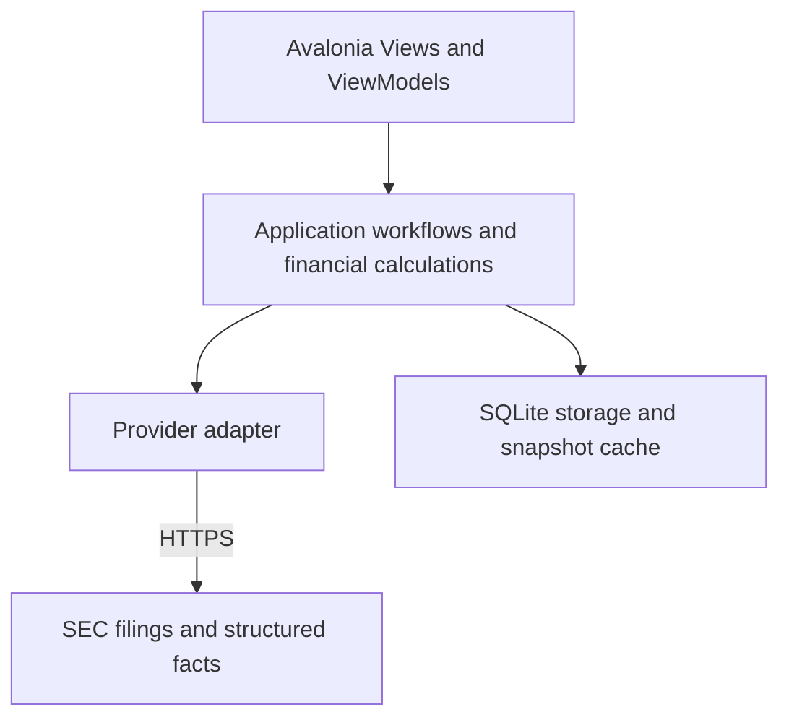
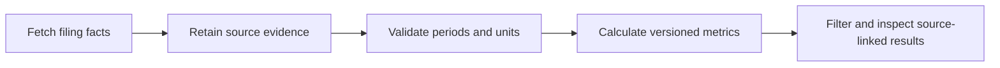
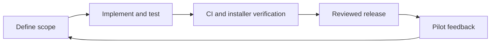

# AlphaQuant Project Proposal and Development Record

Document revision: 0.4
Last updated: 2026-10-25 Asia/Singapore  
Product status: planning, no application implemented  
Working name: AlphaQuant  

## 1 Purpose and document authority

AlphaQuant is a proposed desktop stock screener for financial analysts and financially knowledgeable users. It will automate selected financial-data collection and make a small set of clearly defined analyses accessible through a usable GUI. The product is intended for production use, with traceable calculations, tested releases, and reliable desktop distribution.

This is both the product proposal and the living development record. Read sections 16 through 19 for current progress. Approved project decisions, proposed implementation details, and verified implementation facts must remain distinct. A planned feature is not an implemented feature.

## 2 Business problem and target users

The working problem hypothesis is that collecting filings, reconciling reporting periods, and constructing repeated screening calculations creates manual work and inconsistent spreadsheet workflows. Validate this with prospective users before promising time savings or broad differentiation.

Primary audience: analysts or users comfortable interpreting financial statements. Initial reach: a limited pilot group. Do not assume professional adoption, willingness to pay, or broad market coverage.

Proposed first workflow: select a small universe of companies, retrieve annual filing facts, inspect data quality and provenance, calculate a few comparable metrics, filter/sort results, and open the supporting filing. The exact workflow and metrics require scope approval before implementation.

The product should help users inspect evidence and assumptions. It does not promise stock-price prediction, investment performance, or replacement of professional judgment.

## 3 Value proposition and validation

Desired benefits are a clear desktop GUI, less repeated manual collection, reproducible financial calculations, and inspectable source evidence. These are hypotheses to validate against spreadsheets and existing screeners, not claims of uniqueness.

Before expanding scope, conduct a small number of workflow interviews and prototype sessions. Ask users to show a real recurring task, required metrics, current tools, common data failures, and a result they would trust. Record findings without sensitive employer or portfolio information.

Proposed pilot success criteria, to agree before recruitment:

- Several target users complete one screening workflow without developer assistance.
- Users can identify the source and definition of each displayed metric.
- At least some pilot users return for a second screening session.
- At least one release improvement is driven by observed feedback.
- A repeatable task is benchmarked against the previous workflow before claiming time savings.

Business model is undecided. Begin with a limited pilot, not a payment platform. Budget for signing/distribution, data access, hosting only if needed, and maintenance. Review provider terms before redistribution or monetization. Public accessibility does not imply unrestricted redistribution rights.

## 4 Approved direction and proposed boundaries

### Agreed project direction

- Project and local repository name: AlphaQuant.
- Choose the C# desktop option discussed: .NET with Avalonia as the intended UI framework.
- Develop through releases. Version 1 should contain basic functionality and a few basic financial analyses.
- Test and document each increment; keep the codebase structured, readable, maintainable, and easy to debug.
- Build for real users, visual usability, robustness, and clear documentation.
- Keep this proposal current as requirements, decisions and implementation evolve.

### Proposed v1 scope for review

- Windows x64 first; retain cross-platform boundaries without claiming other OS support.
- A small, explicitly bounded universe of US domestic non-financial companies using annual US-GAAP filing facts.
- Search/select companies, local watchlist, cancellable refresh, cached results, basic screening controls, and source-linked company detail.
- Three candidate metrics defined below. Their inclusion is not yet approved.
- Local single-profile desktop use, without cloud accounts, shared portfolios, billing, or a hosted API.

Out of v1: broad exchange coverage, real-time prices, price targets, backtesting, trading, recommendations, LLM analysis, bank/broker integrations, multi-user cloud collaboration, parameter simulations, and arbitrary custom formula execution.

## 5 Candidate financial analyses and correctness rules

Validate these with prospective users before implementing them. They are examples that avoid requiring live price data.

| Candidate | Definition | Comparability and missing-data rules |
|---|---|---|
| Annual revenue growth | (Revenue in year t / revenue in year t-1 - 1) × 100 | Require comparable annual periods and currency; prior revenue must be positive. Missing/zero prior values yield unavailable with a reason. |
| Annual net profit margin | Consolidated net income / revenue × 100 | Use compatible annual scope and periods; revenue must be positive. Distinguish consolidated profit from profit attributable to a different ownership scope. |
| Current ratio | Current assets / current liabilities | Same balance-sheet date, currency and scope; liabilities must be positive. Exclude issuers without comparable classified balance sheets. |

Each metric must have a versioned definition, supported fact mappings, units, period selection rule, exceptional cases, and reviewed example fixtures. Record which taxonomy tags are accepted; do not select any tag containing a familiar word or blindly sum alternatives. Treat unsupported industry/accounting structures as unsupported rather than forcing a value.

Use C# decimal for financial values within its validated range; parse provider values without a floating-point round trip. Persist decimal values losslessly, for example as invariant strings with explicit units. Round for display only. Ratio outputs are deterministic functions of versioned inputs. Test zero/negative denominators, absent facts, overflow, restatements and inconsistent currency.

Show reporting start/end dates, filing date, form, units, accession/source URL, retrieval time, metric-definition version and quality warnings. A filing amendment or restatement must not silently replace historical evidence. Define an explicit latest-available-as-of policy. Never describe current snapshots as suitable for unbiased historical backtesting.

## 6 Technology stack and rationale

| Concern | Proposed choice | Reason and boundary |
|---|---|---|
| Language/runtime | C# on .NET 10 LTS, current servicing patch | Strong typing, async I/O, decimal arithmetic, debugging and a supported runtime. Pin the SDK in global.json when code is scaffolded. |
| Desktop UI | Avalonia, compatible supported stable version | XAML desktop UI with a path to other platforms. Verify package/runtime compatibility in the first spike; do not select a prerelease by default. |
| Presentation pattern | MVVM with CommunityToolkit.Mvvm | Keep views and business logic separate with limited boilerplate; avoid creating layers for every trivial action. |
| HTTP and JSON | HttpClient and System.Text.Json | Built-in facilities; typed provider DTOs, explicit timeouts, cancellation and validation. |
| Persistence | SQLite through Microsoft.Data.Sqlite | Local transactions, watchlists, provenance and cache metadata without running a database server. Versioned SQL migrations. |
| Testing | xUnit, .NET test tooling, suitable Avalonia headless tests | Pure calculation tests, provider fixtures, storage integration and view-model coverage. A real Windows installer smoke test remains necessary. |
| Logging | Microsoft.Extensions.Logging with a bounded local sink | Structured diagnostics and correlation IDs; exclude tokens and sensitive user details. Add a third-party sink only if needed. |
| CI/releases | GitHub Actions as implementation begins | Reproducible restore/build/test/package; release artifacts tied to commits, changelog and checksums. |

Do not add Python, a web backend, containers, Redis, queues, or microservices without a concrete requirement. Do not claim reduced bundle size from the language choice alone: measure self-contained publish output and installed footprint.

## 7 Architecture and repository structure




Prefer three production projects and one test project initially:

```text
src/
  AlphaQuant.Desktop/       Views, ViewModels, composition, platform integration
  AlphaQuant.Core/          Models, pure metrics, screening and workflow contracts
  AlphaQuant.Infrastructure/ SEC client, parsing, SQLite and migrations
tests/
  AlphaQuant.Tests/         Unit, provider, persistence and view-model tests
    Fixtures/              Small source-attributed synthetic/redacted test inputs
docs/                      Product architecture and release documentation as needed
AlphaQuant_Proposal.md
README.md
```

This is a target layout, not existing code. Core must not depend on Avalonia or SQLite. Infrastructure implements the narrow contracts the workflows actually need. Desktop composes the application. Add projects only when independent responsibilities justify them; no generic repository framework or dependency injection container is required for its own sake.

All network and storage work must be asynchronous/cancellable or appropriately scheduled off the UI thread. Use bounded concurrency and progress reporting; a refresh must not freeze the interface. Avoid Task.Run around naturally asynchronous HTTP. Prefer a single coordinated local write path to prevent unnecessary SQLite contention.

## 8 Data ingestion and provenance

Use official SEC submissions and company-facts endpoints first. SEC JSON APIs require no API key, but identify the application and contact appropriately and comply with current automated-access policies. Confirm current rate limits before enabling bulk ingestion; use a conservative configurable limiter, Retry-After-aware backoff, and bounded retries. Never retry indefinitely or fan out requests per UI component.

SEC company facts do not cover every custom taxonomy concept or make all company facts comparable. Build reviewed mappings and show unsupported results explicitly. Company identity uses CIK and source metadata rather than ticker alone. Fiscal years may differ, and reported durations must drive annual selection rather than calendar labels alone.



Suggested ingestion pipeline:

1. Resolve an approved company identifier and required filing metadata.
2. Reuse an eligible cached response, or fetch with bounded timeout and cancellation.
3. Store a raw response snapshot or content-addressed cached file with retrieval metadata.
4. Validate DTO shape, normalize selected facts, and attach accession, periods, unit and source lineage.
5. Calculate only metrics with valid comparable inputs.
6. Commit a consistent snapshot and surface freshness/quality to the UI.

Store raw caches in OS application-data directories, outside Git. Record content hashes, schema/parser version and a retention policy. Cache failures must not corrupt previous usable snapshots. Stale values remain labelled stale; missing values never become zero. A cancelled refresh leaves a recoverable consistent state.

For large universes, revisit SEC bulk data or a centralized compliant ingestion service. Independent desktop clients do not coordinate provider-wide limits. Review provider terms and sustainable access before scaling distribution. A future commercial provider key owned by the developers must never be embedded in an installer; use approved user-supplied credentials or a server-side service if needed.

## 9 Local data model and resilience

Suggested records: companies, filings, source_snapshots, normalized_facts, metric_results, watchlists, screening_presets, schema_versions and refresh_runs. Implement only records needed for the selected vertical slice.

- Facts record entity, concept, value, unit, period, filing/accession, source and normalization version.
- Results reference their exact inputs and metric version; invalid results include a structured reason.
- Refresh runs track start/end/status and sanitized diagnostics.
- Watchlists/presets store user choices separately from reproducible source caches.

Use parameterized SQL, foreign keys and transactions. Introduce migrations before user data exists. Back up user-owned settings before risky upgrades; raw provider caches can be rebuilt. Prefer additive migrations. Older binaries must detect an incompatible schema rather than corrupting it. Test interrupted writes, unavailable network, corrupt cache entries and migration failure.

The desktop database is local storage, not a security boundary against the device owner. Store future provider tokens in the OS credential store, not plain SQLite or application configuration. No telemetry containing financial selections or identifiers should be enabled without an explicit privacy decision.

## 10 User interface and accessibility

Proposed primary screens: screener grid, company detail with evidence, watchlist, refresh status and settings/about. Keep a narrow navigation flow. The grid should allow sorting/filtering selected metrics and distinguish missing, unsupported, stale and valid values.

Company detail must explain the formula and open the source filing. Users should see data periods before interpreting metrics. Preserve screen state during refresh. Offer useful error messages, retry/cancel, empty/loading states and no unexplained spinner. Support keyboard use, readable contrast and scaling; do not communicate data quality through color alone.

Measure responsiveness and footprint on a named reference machine and dataset before claiming performance. Proposed v1 target: cached operations feel immediate on a 100-company dataset, with long refreshes running in the background. Set numerical acceptance budgets after the first measured spike rather than inventing benchmarks.

## 11 Release plan

Release contents become binding only when their scope is approved. Do not implement the whole roadmap in one change.

| Release | Intended outcome | Exit criteria |
|---|---|---|
| 0.1 foundation | Runnable UI shell and one real company data path | A clean checkout can restore/build/run; CI and a fixture-backed calculation test pass; source evidence visible. |
| 0.2 alpha | Small company universe and candidate metrics | Approved definitions/mappings, filters, cache, cancellation, migrations and meaningful negative tests work. |
| 0.3 beta | Installable pilot with a complete workflow | Clean-machine install/upgrade smoke test, readable UI, documentation, bounded diagnostics, known limitations and feedback channel. |
| 1.0 | Basic screener and a few approved analyses for real users | Release gate below passes; release review completed; pilot issues triaged and no known critical correctness/security defect. |
| 1.1 onward | Improvements justified by usage | Each feature has scope, tests, migration/compatibility assessment and release notes. |
| Later exploration | Parameter simulations or broader data coverage | Separate domain requirements, model assumptions and validation. No claim that changing inputs predicts market price. |



Use descriptive feature branches and cohesive commits, with peer-reviewed pull requests. Record why a tradeoff was chosen. Tag actual releases; semantic versioning should reflect documented compatibility, including data schema, exports and settings. A major version is not required for every UI change.

## 12 Verification and release gate

Every iteration must update affected tests and documentation. Use meaningful tests rather than assertions that simply mirror implementation.

- Unit: independently checked metric fixtures, decimal handling, denominators, annual periods, restatements, taxonomy alternatives, missing and unsupported inputs.
- Provider contracts: saved fixtures for normal, amended, malformed and missing facts. Test rate limiting, 429/5xx responses, backoff and cancellation using a fake handler; do not make live SEC access a required PR test.
- Integration: temporary SQLite files, migrations from supported previous versions, transaction rollback, persistence round trips and cache corruption recovery.
- UI/view models: filtering, stale/quality states, refresh progress, cancellation and error recovery. Supplement headless checks with actual desktop interaction.
- Distribution: clean supported Windows environment; install, first launch, offline cached use, upgrade preserving watchlists, and uninstall with an explicit data-retention choice.

The 1.0 gate requires reviewed formulas and source traceability, passing required CI, no known critical security/correctness issues, no secrets in tracked files, successful installer/upgrade tests, recovery instructions, README matching behavior and clearly documented scope limitations. Coverage percentages alone are not a release gate.

## 13 Distribution operations and security

The initial deployment is a desktop installer, not an AWS web server. No cloud hosting is assumed. A static download page or GitHub Releases may distribute installers when a remote, budget and visibility are agreed.

Start with manual release approval and a CI-built artifact; validate signing and Windows trust behavior before broad distribution. Signing credentials belong in protected release secrets, never in the repository. Publish checksums and release notes. Automatic updates are a later task until authenticity verification, interrupted-update recovery and package compatibility are tested. Do not claim the application is signed until it is verified.

CI should pin the .NET SDK and dependencies, restore deterministically, check formatting/build warnings, run tests and audit packages for known vulnerabilities. Confirm exact CLI commands against the pinned SDK when implementation begins. Separate untrusted PR execution from secrets-bearing release jobs and restrict release permissions. Do not run privileged pipelines for unreviewed code.

Use HTTPS and certificate validation. Do not render remote executable content or execute arbitrary user formulas in v1. Limit download size and parsing resources. Validate external URLs before opening them. Logs should rotate and redact secrets. Provide an opt-in sanitized diagnostics export; crash reporting and usage telemetry remain off until reviewed.

Record incidents with release version, impact, cause, fix and verification. A desktop rollback may not be safe after a schema migration; preserve settings backups and document supported recovery paths. Keep infrastructure proportionate to the desktop deployment model.

## 14 Documentation and product validation

Maintain an accurate README, architecture diagram, setup/run/test instructions, known limitations, changelog and release notes. Use source-attributed synthetic or public-data examples in demonstrations and verify redistribution conditions.

Measure workflow completion, repeat usage where users consent, feedback resolved and release outcomes. Publish only measured adoption, performance and reliability claims. Use small reviewable changes and record significant technical tradeoffs.

## 15 Risks and open decisions

| Risk or decision | Required action |
|---|---|
| Metrics and first workflow not selected | Interview users; approve exact v1 metrics, scope and input rules before implementing them. |
| Market/data coverage unclear | Confirm proposed US domestic non-financial annual scope and define exclusions. |
| OS and resources | Confirm Windows x64 target, reference hardware and installer expectations; other OS releases need their own QA. |
| Package/runtime compatibility | Verify stable Avalonia/.NET/toolkit combination with a minimal runnable spike. |
| Data access/redistribution | Review current SEC policies and any additional provider terms before ingestion at scale or publication. |
| Budget, licensing and public release | Agree signing costs, distribution channel, repository visibility, project license and dependency obligations before publication. |
| Wrong or incomparable financial data | Version mappings, preserve provenance, show warnings and test reviewed examples; restrict coverage when necessary. |
| Delivery and maintainability | Work in small releases; no calendar delivery promise until a vertical slice is measured. |
| Name availability | AlphaQuant is a working name; check naming/trademark availability before public branding. |

## 16 Instructions for developers and agents

### Project context and authority

This tracked proposal is the shared, self-contained continuation record for AlphaQuant across developers, agents, chats and laptops. Do not assume access to earlier conversations or another machine. Keep all substantive project context here: requirements, ideas, decisions and rationale, alternatives considered, scope, architecture, implementation progress, verification, known issues, blockers and exact next actions. A new contributor must be able to continue from a fresh checkout and this document without needing chat history.

Record project-relevant discussion as concise, durable facts rather than conversation transcripts. Distinguish proposed ideas, approved requirements, rejected or deferred alternatives, superseded decisions, implemented behavior and verified results. A suggestion is not approval; a plan is not working software. Retain the reason for changed direction and link a superseded decision to its replacement. Keep credentials, personal information and private motivations out of public content.

### Start of every task

1. Read this proposal and README, then inspect relevant source, tests and recent commits. Start with sections 17 through 19 for the current state; consult earlier sections for definitions and constraints.
2. Inspect Git status, branch and remotes. Fetch the configured remote and fast-forward the appropriate branch only when safe. Preserve local changes and reconcile divergence deliberately; never reset or rewrite history as a routine refresh.
3. Compare documentation with actual files and verification evidence. Record discrepancies and resolve them before relying on stale claims. Missing context must remain an explicit open question rather than an invented requirement.
4. Select one small milestone with observable acceptance criteria. Use a descriptive feature branch. Resolve routine engineering choices autonomously; seek clarification for material product or financial decisions, missing credentials or actions beyond existing authority.

### During development and discussion

Update this proposal whenever a substantive requirement, idea, decision, implementation result or blocker changes, including planning-only sessions. Save the context when the change is established and before handing off or ending a session; do not wait for a release. Keep the applicable detailed sections and the current-state summary aligned with the dated logs.

For each material idea, record its purpose, status, rationale, affected scope and next validation step. Record rejected or deferred alternatives when their rationale will prevent repeated discussion. For implementation, record changed behavior, relevant files, the commit or branch when available, checks actually run and their results, limitations and unfinished work. Never reuse stale test results as current evidence.

Keep UI, calculations, ingestion and persistence responsibilities clear. Implement only approved financial scope. Use reviewed fixtures, explicit periods and units, missing-data handling and source lineage as financial behavior is introduced. Run proportionate checks for each increment and preserve the architecture, data-flow and release diagrams as the design changes.

### Completion and synchronization

1. Update sections 17 through 19 with completed work, actual verification, remaining issues and one exact next action. Add dated decision records for changed direction; update detailed requirements and README when affected.
2. Keep the local PDF edition synchronized with this proposal after substantive changes. Preserve any private-only prefix in its editable source, refresh the shared proposal content, regenerate the PDF and visually inspect every page. The local PDF and its source remain untracked; Git does not transfer them between laptops. A fresh checkout must still have complete shared project context in this tracked document. Report unavailable local files or failed regeneration explicitly.
3. Inspect status, filenames and diffs before staging. Check ignore rules and scan staged content for secrets and private information. Never force-add private artifacts. Commit coherent changes and push the agreed feature branch when authorized; preserve peer review and required checks before merging or releasing.
4. Report saved, verified, committed and pushed states separately. If a file is locked, a check fails or synchronization is blocked, preserve the work and record what remains pending. Never claim a local save is remotely synchronized.
5. On another laptop, fetch the latest branch and repeat the startup checks. Reconcile concurrent proposal edits deliberately and coordinate local-edition updates. Do not depend on ignored files or an earlier chat for shared requirements and decisions.

## 17 Current state and next action

As of 2026-10-25: local repository prepared with this proposal, README and .gitignore. No application projects, dependencies, tests, installers or financial calculations are implemented. The public source repository is https://github.com/minwaiphyo/AlphaQuant. No application deployment exists.

Next action: scope review sections 4, 5 and 15, then choose the first metric and supported universe. A minimal C#/Avalonia compatibility/UI spike can proceed as a foundation task, but the proposed full metric set must not be treated as approved. Implementation has not started.

Pending decisions: exact metrics, fiscal/coverage rules, Windows target, budget, license and publication channel. Blockers for public release: all implementation and release gates remain outstanding.

## 18 Decision log

| ID and date | Status | Decision and reason | Source |
|---|---|---|---|
| AQ-D001 2026-10-25 | Approved | Use C# desktop option; use a maintainable desktop application stack. Avalonia is the intended UI direction from the accepted option. | Architecture decision. |
| AQ-D002 2026-10-25 | Approved | Develop in tested, documented releases, with basic functionality and a few basic analyses in v1. | Release policy. |
| AQ-D003 2026-10-25 | Approved | Name project/repository AlphaQuant and create it under Projects; maintain a current product and engineering development record. | Project planning decision. |
| AQ-D005 2026-10-25 | Approved | Keep complete shared project context and developer/agent continuation instructions in this tracked proposal; update substantive ideas and development changes promptly and synchronize the untracked local PDF. | Cross-device continuation workflow. |
| AQ-D004 2026-10-25 | Proposed | Windows first, .NET 10, SQLite, toolkit, small annual US filing universe and candidate metrics. | Architecture defaults in this proposal; subject to scope review. |

New record template: ID, date/timezone, approved/proposed/superseded status, decision, stated rationale, source, affected scope, replaced decision if any.

## 19 Work log and release record

| Date | Work and verification | Remaining |
|---|---|---|
| 2026-10-25 | Expanded the tracked continuation workflow and context-recording requirements; synchronized the local edition. Documentation only; no application tests apply. | Review initial workflow, metric and universe scope before implementation. |
| 2026-10-25 | Maintained the architecture, ingestion and release documentation. Documentation only. | Application implementation and release gates remain outstanding. |
| 2026-10-25 | Created planning repository, proposal, README and ignore rules. Reviewed official .NET, Avalonia, MVVM and SEC references. Documentation-only work; no application verification claimed. | Scope review, implementation spike and all release gates. |

Work entry template: date, actor, task/decision IDs, completed changes and files, commit reference if known, checks/results, limitations, blockers and exact next action.

Release entry template: version/tag, date, commit, supported OS, features/fixes, metric-definition versions, schema changes, tests and installer results, known issues, artifacts/checksums/signing status, recovery notes and feedback follow-up. No product releases exist yet.

## 20 Reference documentation

- [Avalonia](https://docs.avaloniaui.net/docs/welcome)
- [.NET releases and support](https://learn.microsoft.com/en-us/dotnet/core/releases-and-support)
- [CommunityToolkit MVVM](https://learn.microsoft.com/en-us/dotnet/communitytoolkit/mvvm/)
- [SEC EDGAR APIs](https://www.sec.gov/search-filings/edgar-application-programming-interfaces)

References checked 2026-10-25. Recheck versions, provider policies and distribution requirements before implementation or release.
