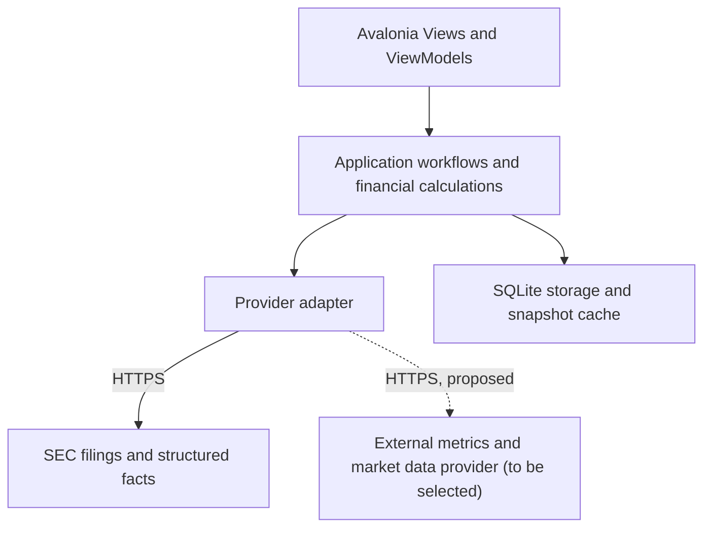
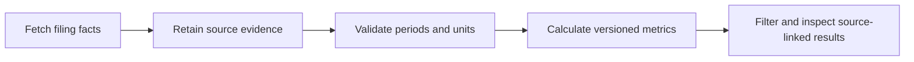
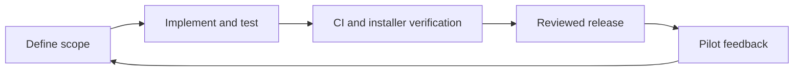

# AlphaQuant Project Proposal and Development Record

Document revision: 0.6
Last updated: 2026-10-26 Asia/Singapore  
Product status: planning, no application implemented  
Working name: AlphaQuant  

## 1 Purpose and document authority

AlphaQuant is a proposed transparent desktop screening and valuation workspace for financial analysts and financially knowledgeable users who want to accelerate stock research without rebuilding Excel models from scratch. It will automate selected financial-data collection and make a small set of clearly defined analyses accessible through a usable GUI. Screening comes first; valuation is a later, separately approved phase (AQ-D007). The product is intended for production use, with traceable calculations, tested releases, and reliable desktop distribution.

This is both the product proposal and the living development record. Read sections 16 through 19 for current progress. Approved project decisions, proposed implementation details, and verified implementation facts must remain distinct. A planned feature is not an implemented feature.

## 2 Business problem and target users

The working problem hypothesis is that collecting filings, reconciling reporting periods, and constructing repeated screening and valuation calculations creates manual work and inconsistent spreadsheet workflows. Validate this with prospective users before promising time savings or broad differentiation. Problems to test:

- repeated manual extraction from annual reports and financial statements;
- inconsistent handling of periods, units and filing structure;
- slow preparation of screening workflows, and later valuation workflows;
- spreadsheet errors and hidden assumptions;
- inconsistent peer comparison;
- no structured, auditable record of research.

Primary audience: analysts or users comfortable interpreting financial statements, such as independent investors with a finance background, equity analysts, portfolio managers or investment associates, wealth-management and advisory professionals, and serious personal investors who keep watchlists and models. They are not assumed to be software developers and want speed, consistency and defensible analysis rather than a black-box trading engine. Initial reach: a limited pilot group. Do not assume professional adoption, willingness to pay, or broad market coverage.

Proposed positioning (provisional, AQ-D006): AlphaQuant is a transparent desktop valuation and screening workspace for investors and analysts who want to accelerate stock research without rebuilding Excel models from scratch. It is a research and decision-support tool, not a trading system, recommendation engine or source of guaranteed returns.

Proposed first workflow: select a small universe of companies, retrieve annual filing facts, inspect data quality and provenance, calculate a few comparable metrics, filter/sort results, and open the supporting filing. The exact workflow and metrics require scope approval before implementation.

The product should help users inspect evidence and assumptions. It does not promise stock-price prediction, investment performance, or replacement of professional judgment.

## 3 Value proposition and validation

Desired benefits are a clear desktop GUI, less repeated manual collection, reproducible financial calculations, and inspectable source evidence. These are hypotheses to validate against spreadsheets and existing screeners, not claims of uniqueness.

Candidate differentiators to test with users (hypotheses, not established advantages):

- Analyst-first workflow for people who know finance and want to work faster, not casual retail trading.
- Transparent, adjustable assumptions and explainable outputs. In v1 this means screening thresholds, peer/universe choice and metric definitions; adjustable growth, margin, discount-rate and terminal-value inputs belong to the later valuation phase.
- Source-linked analysis tied to filing facts, periods and quality warnings.
- A lighter local desktop workflow than institutional platforms. Verify this against real alternatives before claiming it.
- Later: scenario-based analysis without duplicating spreadsheets.

Compare against generic screeners, institutional platforms and spreadsheets in the first user interviews. Record what users already use and what they distrust.

Before expanding scope, conduct a small number of workflow interviews and prototype sessions. Ask users to show a real recurring task, required metrics, current tools, common data failures, and a result they would trust. Record findings without sensitive employer or portfolio information.

Proposed pilot success criteria, to agree before recruitment:

- Several target users complete one screening workflow without developer assistance.
- Users can identify the source and definition of each displayed metric.
- At least some pilot users return for a second screening session.
- At least one release improvement is driven by observed feedback.
- A repeatable task is benchmarked against the previous workflow before claiming time savings.

Business model is undecided. Begin with a limited pilot, not a payment platform. Options to evaluate later, none selected: one-time desktop license; a paid professional tier with the valuation phase; optional subscription for additional universes or premium data; optional support or data packages. Premium data implies data-provider licensing and cost, so model provider cost before pricing. Budget for signing/distribution, data access, hosting only if needed, and maintenance. Review provider terms before redistribution or monetization. Public accessibility does not imply unrestricted redistribution rights.

## 4 Approved direction and proposed boundaries

### Agreed project direction

- Project and local repository name: AlphaQuant.
- Choose the C# desktop option discussed: .NET with Avalonia as the intended UI framework.
- Develop through releases. Version 1 should contain basic functionality and a few basic financial analyses.
- Test and document each increment; keep the codebase structured, readable, maintainable, and easy to debug.
- Build for real users, visual usability, robustness, and clear documentation.
- Keep this proposal current as requirements, decisions and implementation evolve.
- Use the screening-and-valuation workspace direction in section 2 as the working business proposal for now (AQ-D006, provisional; subject to user validation).
- Valuation analysis (DCF, scenarios) is a later phase, not part of v1 (AQ-D007).
- Plan on external data providers for financial metrics and documents, including SEC filings. Provider selection, terms and v1 usage remain open (AQ-D008).

### Product principles

- Show where each number comes from; separate raw filing data from calculated outputs.
- Surface missing, stale or unsupported data; never silently force an unsupported accounting structure into a result.
- Make assumptions and thresholds explicit and adjustable where a workflow uses them.
- Avoid false precision. Make no prediction, guaranteed-return or buy/sell claims, and no opaque AI judgments.
- Support research; do not automate trading.

### Proposed v1 scope for review

- Windows x64 first; retain cross-platform boundaries without claiming other OS support.
- A small, explicitly bounded universe of US domestic non-financial companies using annual US-GAAP filing facts.
- Search/select companies, local watchlist, saved screening presets, cancellable refresh, cached results, basic screening controls (threshold rules, ranking, sorting), and source-linked company detail.
- Three candidate metrics defined below. Their inclusion is not yet approved.
- Local single-profile desktop use, without cloud accounts, shared portfolios, billing, or a hosted API.
- SEC filings are the first source. Whether v1 also uses a provider for additional metrics is open (section 8).

Candidates not yet placed in a release: per-company notes and recorded assumptions, and export of summaries to spreadsheet or PDF. Decide their release at scope review.

Out of v1: valuation analysis (DCF builder, peer valuation comparison, valuation multiples, terminal-value inputs, sensitivity analysis and base/bull/bear scenarios), price-dependent analytics, broad exchange coverage, real-time prices, price targets, backtesting, trading, recommendations, LLM analysis, bank/broker integrations, multi-user cloud collaboration, parameter simulations, and arbitrary custom formula execution. Valuation is a planned later phase (section 11).

## 5 Candidate financial analyses and correctness rules

Validate these with prospective users before implementing them. They are examples that avoid requiring live price data.

| Candidate | Definition | Comparability and missing-data rules |
|---|---|---|
| Annual revenue growth | (Revenue in year t / revenue in year t-1 - 1) × 100 | Require comparable annual periods and currency; prior revenue must be positive. Missing/zero prior values yield unavailable with a reason. |
| Annual net profit margin | Consolidated net income / revenue × 100 | Use compatible annual scope and periods; revenue must be positive. Distinguish consolidated profit from profit attributable to a different ownership scope. |
| Current ratio | Current assets / current liabilities | Same balance-sheet date, currency and scope; liabilities must be positive. Exclude issuers without comparable classified balance sheets. |

Each metric must have a versioned definition, supported fact mappings, units, period selection rule, exceptional cases, and reviewed example fixtures. Record which taxonomy tags are accepted; do not select any tag containing a familiar word or blindly sum alternatives. Treat unsupported industry/accounting structures as unsupported rather than forcing a value.

### Later valuation phase (candidate, not approved, not in v1)

Intended capabilities, to be specified separately before any implementation: a simple DCF with adjustable assumptions, peer valuation comparison, valuation-multiple analysis, terminal-value inputs, sensitivity analysis and base/bull/bear/conservative scenarios. Prerequisites to resolve first:

- Reviewed definitions: free cash flow, projection horizon, discount rate, terminal growth or exit multiple, net debt, share count and treatment of dilution.
- Additional fact mappings, for example operating cash flow, capital expenditure, debt, cash and shares outstanding, each with units, period rules and exceptional cases.
- A market-price and peer-data source, which depends on the provider decision (AQ-D008). Price-dependent results must record price source, date and licence terms.
- Presentation rules: outputs are assumption-driven illustrative values, not price targets or recommendations. Show the assumptions, scenario and inputs beside every result.
- Reviewed example models with independently checked results, and negative tests for invalid or inconsistent assumptions.

Use C# decimal for financial values within its validated range; parse provider values without a floating-point round trip. Persist decimal values losslessly, for example as invariant strings with explicit units. Round for display only. Ratio outputs are deterministic functions of versioned inputs. Test zero/negative denominators, absent facts, overflow, restatements and inconsistent currency.

Show reporting start/end dates, filing date, form, units, accession/source URL, retrieval time, metric-definition version and quality warnings. A filing amendment or restatement must not silently replace historical evidence. Define an explicit latest-available-as-of policy. Never describe current snapshots as suitable for unbiased historical backtesting.

## 6 Technology stack and rationale

| Concern | Proposed choice | Reason and boundary |
|---|---|---|
| Language/runtime | C# on .NET 10 LTS, current servicing patch | Strong typing, async I/O, decimal arithmetic, debugging and a supported runtime. Pin the SDK in global.json when code is scaffolded. |
| Desktop UI | Avalonia, compatible supported stable version | XAML desktop UI with a path to other platforms. Verify package/runtime compatibility in the first spike; do not select a prerelease by default. |
| Presentation pattern | MVVM with CommunityToolkit.Mvvm | Keep views and business logic separate with limited boilerplate; avoid creating layers for every trivial action. |
| HTTP and JSON | HttpClient and System.Text.Json | Built-in facilities; typed provider DTOs, explicit timeouts, cancellation and validation. |
| Persistence | SQLite through Microsoft.Data.Sqlite | Local transactions, watchlists, provenance and cache metadata without running a database server. Versioned SQL migrations. |
| Testing | xUnit, .NET test tooling, suitable Avalonia headless tests | Pure calculation tests, provider fixtures, storage integration and view-model coverage. A real Windows installer smoke test remains necessary. |
| Logging | Microsoft.Extensions.Logging with a bounded local sink | Structured diagnostics and correlation IDs; exclude tokens and sensitive user details. Add a third-party sink only if needed. |
| CI/releases | GitHub Actions as implementation begins | Reproducible restore/build/test/package; release artifacts tied to commits, changelog and checksums. |

Do not add Python, a web backend, containers, Redis, queues, or microservices without a concrete requirement. Do not claim reduced bundle size from the language choice alone: measure self-contained publish output and installed footprint.

## 7 Architecture and repository structure



The dashed provider is an approved direction (AQ-D008) with no selected vendor and no implementation. Core consumes provider data only through the adapter contract, so sources stay replaceable.


Prefer three production projects and one test project initially:

```text
src/
  AlphaQuant.Desktop/       Views, ViewModels, composition, platform integration
  AlphaQuant.Core/          Models, pure metrics, screening and workflow contracts
  AlphaQuant.Infrastructure/ SEC client, parsing, SQLite and migrations
tests/
  AlphaQuant.Tests/         Unit, provider, persistence and view-model tests
    Fixtures/              Small source-attributed synthetic/redacted test inputs
docs/                      Product architecture and release documentation as needed
AlphaQuant_Proposal.md
README.md
```

This is a target layout, not existing code. Core must not depend on Avalonia or SQLite. Infrastructure implements the narrow contracts the workflows actually need. Desktop composes the application. Add projects only when independent responsibilities justify them; no generic repository framework or dependency injection container is required for its own sake.

All network and storage work must be asynchronous/cancellable or appropriately scheduled off the UI thread. Use bounded concurrency and progress reporting; a refresh must not freeze the interface. Avoid Task.Run around naturally asynchronous HTTP. Prefer a single coordinated local write path to prevent unnecessary SQLite contention.

## 8 Data ingestion and provenance

Use official SEC submissions and company-facts endpoints first. SEC JSON APIs require no API key, but identify the application and contact appropriately and comply with current automated-access policies. Confirm current rate limits before enabling bulk ingestion; use a conservative configurable limiter, Retry-After-aware backoff, and bounded retries. Never retry indefinitely or fan out requests per UI component.

Data provider direction (AQ-D008, approved direction; vendor and v1 usage open): AlphaQuant is expected to draw on external data providers for financial metrics and market data as well as filing documents such as SEC filings. SEC remains the first, authoritative source for filing facts. Provider data must carry the same lineage as SEC data: source, retrieval time, period, unit and licence-relevant metadata, and must stay separate from raw filing evidence so differences between sources are visible. Before selecting a provider, review coverage, point-in-time and restatement handling, pricing, rate limits, and terms on caching, local storage, export and redistribution. Prefer user-supplied credentials or a compliant server-side service; a developer-owned key must never ship in an installer. Provider selection and any server-side component are separate decisions that need their own scope review, since they affect the local-only operating model.

SEC company facts do not cover every custom taxonomy concept or make all company facts comparable. Build reviewed mappings and show unsupported results explicitly. Company identity uses CIK and source metadata rather than ticker alone. Fiscal years may differ, and reported durations must drive annual selection rather than calendar labels alone.



Suggested ingestion pipeline:

1. Resolve an approved company identifier and required filing metadata.
2. Reuse an eligible cached response, or fetch with bounded timeout and cancellation.
3. Store a raw response snapshot or content-addressed cached file with retrieval metadata.
4. Validate DTO shape, normalize selected facts, and attach accession, periods, unit and source lineage.
5. Calculate only metrics with valid comparable inputs.
6. Commit a consistent snapshot and surface freshness/quality to the UI.

Store raw caches in OS application-data directories, outside Git. Record content hashes, schema/parser version and a retention policy. Cache failures must not corrupt previous usable snapshots. Stale values remain labelled stale; missing values never become zero. A cancelled refresh leaves a recoverable consistent state.

For large universes, revisit SEC bulk data or a centralized compliant ingestion service. Independent desktop clients do not coordinate provider-wide limits. Review provider terms and sustainable access before scaling distribution. A future commercial provider key owned by the developers must never be embedded in an installer; use approved user-supplied credentials or a server-side service if needed.

## 9 Local data model and resilience

Suggested records: companies, filings, source_snapshots, normalized_facts, metric_results, watchlists, screening_presets, schema_versions and refresh_runs. Implement only records needed for the selected vertical slice.

- Facts record entity, concept, value, unit, period, filing/accession, source and normalization version.
- Results reference their exact inputs and metric version; invalid results include a structured reason.
- Refresh runs track start/end/status and sanitized diagnostics.
- Watchlists/presets store user choices separately from reproducible source caches.

Use parameterized SQL, foreign keys and transactions. Introduce migrations before user data exists. Back up user-owned settings before risky upgrades; raw provider caches can be rebuilt. Prefer additive migrations. Older binaries must detect an incompatible schema rather than corrupting it. Test interrupted writes, unavailable network, corrupt cache entries and migration failure.

The desktop database is local storage, not a security boundary against the device owner. Store future provider tokens in the OS credential store, not plain SQLite or application configuration. No telemetry containing financial selections or identifiers should be enabled without an explicit privacy decision.

## 10 User interface and accessibility

Proposed primary screens: screener grid, company detail with evidence, watchlist, refresh status and settings/about. Keep a narrow navigation flow. The grid should allow sorting/filtering selected metrics and distinguish missing, unsupported, stale and valid values.

Company detail must explain the formula and open the source filing. Users should see data periods before interpreting metrics. Preserve screen state during refresh. Offer useful error messages, retry/cancel, empty/loading states and no unexplained spinner. Support keyboard use, readable contrast and scaling; do not communicate data quality through color alone.

Measure responsiveness and footprint on a named reference machine and dataset before claiming performance. Proposed v1 target: cached operations feel immediate on a 100-company dataset, with long refreshes running in the background. Set numerical acceptance budgets after the first measured spike rather than inventing benchmarks.

## 11 Release plan

Release contents become binding only when their scope is approved. Do not implement the whole roadmap in one change.

| Release | Intended outcome | Exit criteria |
|---|---|---|
| 0.1 foundation | Runnable UI shell and one real company data path | A clean checkout can restore/build/run; CI and a fixture-backed calculation test pass; source evidence visible. |
| 0.2 alpha | Small company universe and candidate metrics | Approved definitions/mappings, filters, cache, cancellation, migrations and meaningful negative tests work. |
| 0.3 beta | Installable pilot with a complete workflow | Clean-machine install/upgrade smoke test, readable UI, documentation, bounded diagnostics, known limitations and feedback channel. |
| 1.0 | Basic screener and a few approved analyses for real users | Release gate below passes; release review completed; pilot issues triaged and no known critical correctness/security defect. |
| Valuation phase (candidate, after 1.0) | DCF, peer valuation, multiples, scenarios and sensitivity analysis (AQ-D007) | Separate approved scope and definitions (section 5), provider decision (AQ-D008), reviewed example models, assumption display on every result, and no price-target or recommendation framing. |
| 1.1 onward | Improvements justified by usage | Each feature has scope, tests, migration/compatibility assessment and release notes. |
| Later exploration | Parameter simulations or broader data coverage | Separate domain requirements, model assumptions and validation. No claim that changing inputs predicts market price. |



Use descriptive feature branches and cohesive commits, with peer-reviewed pull requests. Record why a tradeoff was chosen. Tag actual releases; semantic versioning should reflect documented compatibility, including data schema, exports and settings. A major version is not required for every UI change.

## 12 Verification and release gate

Every iteration must update affected tests and documentation. Use meaningful tests rather than assertions that simply mirror implementation.

- Unit: independently checked metric fixtures, decimal handling, denominators, annual periods, restatements, taxonomy alternatives, missing and unsupported inputs.
- Provider contracts: saved fixtures for normal, amended, malformed and missing facts. Test rate limiting, 429/5xx responses, backoff and cancellation using a fake handler; do not make live SEC access a required PR test.
- Integration: temporary SQLite files, migrations from supported previous versions, transaction rollback, persistence round trips and cache corruption recovery.
- UI/view models: filtering, stale/quality states, refresh progress, cancellation and error recovery. Supplement headless checks with actual desktop interaction.
- Distribution: clean supported Windows environment; install, first launch, offline cached use, upgrade preserving watchlists, and uninstall with an explicit data-retention choice.

The 1.0 gate requires reviewed formulas and source traceability, passing required CI, no known critical security/correctness issues, no secrets in tracked files, successful installer/upgrade tests, recovery instructions, README matching behavior and clearly documented scope limitations. Coverage percentages alone are not a release gate.

## 13 Distribution operations and security

The initial deployment is a desktop installer, not an AWS web server. No cloud hosting is assumed. A static download page or GitHub Releases may distribute installers when a remote, budget and visibility are agreed.

Start with manual release approval and a CI-built artifact; validate signing and Windows trust behavior before broad distribution. Signing credentials belong in protected release secrets, never in the repository. Publish checksums and release notes. Automatic updates are a later task until authenticity verification, interrupted-update recovery and package compatibility are tested. Do not claim the application is signed until it is verified.

CI should pin the .NET SDK and dependencies, restore deterministically, check formatting/build warnings, run tests and audit packages for known vulnerabilities. Confirm exact CLI commands against the pinned SDK when implementation begins. Separate untrusted PR execution from secrets-bearing release jobs and restrict release permissions. Do not run privileged pipelines for unreviewed code.

Use HTTPS and certificate validation. Do not render remote executable content or execute arbitrary user formulas in v1. Limit download size and parsing resources. Validate external URLs before opening them. Logs should rotate and redact secrets. Provide an opt-in sanitized diagnostics export; crash reporting and usage telemetry remain off until reviewed.

Record incidents with release version, impact, cause, fix and verification. A desktop rollback may not be safe after a schema migration; preserve settings backups and document supported recovery paths. Keep infrastructure proportionate to the desktop deployment model.

## 14 Documentation and product validation

Maintain an accurate README, architecture diagram, setup/run/test instructions, known limitations, changelog and release notes. Use source-attributed synthetic or public-data examples in demonstrations and verify redistribution conditions.

Measure workflow completion, repeat usage where users consent, feedback resolved and release outcomes. Publish only measured adoption, performance and reliability claims. Use small reviewable changes and record significant technical tradeoffs.

## 15 Risks and open decisions

| Risk or decision | Required action |
|---|---|
| Metrics and first workflow not selected | Interview users; approve exact v1 metrics, scope and input rules before implementing them. |
| Market/data coverage unclear | Confirm proposed US domestic non-financial annual scope and define exclusions. |
| OS and resources | Confirm Windows x64 target, reference hardware and installer expectations; other OS releases need their own QA. |
| Package/runtime compatibility | Verify stable Avalonia/.NET/toolkit combination with a minimal runnable spike. |
| Data access/redistribution | Review current SEC policies and any additional provider terms before ingestion at scale or publication. |
| Budget, licensing and public release | Agree signing costs, distribution channel, repository visibility, project license and dependency obligations before publication. |
| Wrong or incomparable financial data | Version mappings, preserve provenance, show warnings and test reviewed examples; restrict coverage when necessary. |
| Delivery and maintainability | Work in small releases; no calendar delivery promise until a vertical slice is measured. |
| Name availability | AlphaQuant is a working name; check naming/trademark availability before public branding. |
| Data provider not selected | Define required metrics and market data, compare vendors on coverage, cost, point-in-time handling and terms on caching, storage and redistribution; decide credential model and whether any server-side service is needed. |
| Valuation framing and liability | Present outputs as assumption-driven illustrations, not price targets or advice. Review disclaimers and any regulatory implications for advisory or wealth-management users before offering the valuation phase. |
| Unvalidated value claims | Treat time savings, lighter weight and differentiation as hypotheses until pilot interviews and benchmarks support them. |
| Scope growth into valuation | Keep v1 to screening; admit valuation features only through a separate approved scope. |

## 16 Product record scope

This proposal records software requirements, product ideas and decisions, architecture, financial definitions, implementation evidence and release status. The current state and dated records below distinguish planned capabilities from implemented and verified behavior.

## 17 Current state and next action

As of 2026-10-26: local repository prepared with this proposal, README and .gitignore. No application projects, dependencies, tests, installers or financial calculations are implemented. The public source repository is https://github.com/minwaiphyo/AlphaQuant. No application deployment exists. The .NET SDK was not found on PATH on the development machine on 2026-10-26, so the stack remains unverified.

Business direction (provisional, AQ-D006): a transparent screening and valuation workspace. v1 covers screening only; valuation (DCF, scenarios, peers, multiples, sensitivity) is a later phase (AQ-D007). External data providers are planned alongside SEC filings (AQ-D008); no vendor is selected.

Next action: scope review sections 4, 5 and 15 with the user to choose the first metric and supported universe, and decide whether v1 uses a provider beyond SEC. Then define one small milestone. A minimal C#/Avalonia compatibility/UI spike needs the .NET SDK installed first and can proceed as a foundation task, but the proposed metric set is not approved. Implementation has not started.

Pending decisions: exact metrics, fiscal/coverage rules, data provider and v1 provider usage, release for notes and export, Windows target, budget, license and publication channel. Blockers for public release: all implementation and release gates remain outstanding.

## 18 Decision log

| ID and date | Status | Decision and reason | Source |
|---|---|---|---|
| AQ-D001 2026-10-25 | Approved | Use C# desktop option; use a maintainable desktop application stack. Avalonia is the intended UI direction from the accepted option. | Architecture decision. |
| AQ-D002 2026-10-25 | Approved | Develop in tested, documented releases, with basic functionality and a few basic analyses in v1. | Release policy. |
| AQ-D003 2026-10-25 | Approved | Name project/repository AlphaQuant and create it under Projects; maintain a current product and engineering development record. | Project planning decision. |
| AQ-D004 2026-10-25 | Proposed | Windows first, .NET 10, SQLite, toolkit, small annual US filing universe and candidate metrics. | Architecture defaults in this proposal; subject to scope review. |
| AQ-D006 2026-10-26 | Approved, provisional | Use the screening-and-valuation workspace proposal (positioning, audience, principles, differentiators as hypotheses, business-model options as undecided) as the working business proposal for now. Reason: it frames a practical, transparent analyst tool without prediction claims. Refine after user validation. | User review of the proposed business direction. |
| AQ-D007 2026-10-26 | Approved | Valuation analysis (DCF, scenarios, peer valuation, multiples, sensitivity) is a later phase after 1.0, not v1. Reason: it needs additional fact mappings, price and peer data, and reviewed definitions; keeping v1 to screening bounds the first release. Specifics are candidates only. | User decision. |
| AQ-D008 2026-10-26 | Approved direction; details open | Use external data providers for financial metrics and market data as well as filing documents such as SEC filings. Reason: price-dependent and peer analyses cannot rely on SEC filings alone. Vendor, terms, credential model, whether v1 needs a provider and any server-side component remain undecided. | User decision. |

Decision records include status, rationale, affected software scope and references to superseded decisions.

## 19 Work log and release record

| Date | Work and verification | Remaining |
|---|---|---|
| 2026-10-26 | Planning session. Adopted the screening-and-valuation business direction provisionally, deferred valuation to a post-1.0 phase, and recorded the external data-provider direction (AQ-D006 to AQ-D008). Updated revision 0.6 sections 1 to 5, 7, 8, 11, 15, 17 and 18 and the README. Documentation only; no application verification claimed. Checked that `dotnet` is not on PATH. Work on branch `docs/business-direction-valuation-staging`. | Choose first metric, universe and v1 provider usage; select a provider; verify .NET/Avalonia; first milestone. |
| 2026-10-25 | Maintained the architecture, ingestion and release documentation. Documentation only. | Application implementation and release gates remain outstanding. |
| 2026-10-25 | Created planning repository, proposal, README and ignore rules. Reviewed official .NET, Avalonia, MVVM and SEC references. Documentation-only work; no application verification claimed. | Scope review, implementation spike and all release gates. |

Engineering records include changed software behavior, relevant files and commits, verification evidence, limitations and remaining work.

No product releases exist yet. Future release records will identify the version, source commit, supported OS, changes, metric and schema versions, verification, known issues, artifacts, signing status and recovery notes.

## 20 Reference documentation

- [Avalonia](https://docs.avaloniaui.net/docs/welcome)
- [.NET releases and support](https://learn.microsoft.com/en-us/dotnet/core/releases-and-support)
- [CommunityToolkit MVVM](https://learn.microsoft.com/en-us/dotnet/communitytoolkit/mvvm/)
- [SEC EDGAR APIs](https://www.sec.gov/search-filings/edgar-application-programming-interfaces)

References checked 2026-10-25. Recheck versions, provider policies and distribution requirements before implementation or release.
