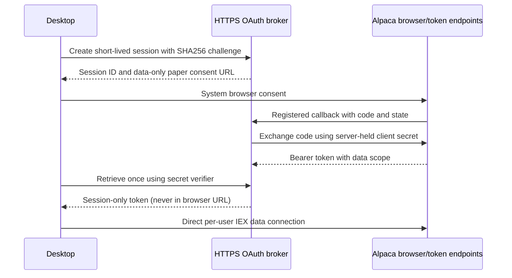

# Alpaca browser OAuth: setup and UI integration

Updated: 2026-10-28. Backend code exists and is fake-provider tested. No OAuth application, hosted service, provider approval or live connection has been created for this project. The Desktop project has intentionally not been modified while the UI teammate works on it.

## Components

- Core: `IMarketDataProvider`, typed prices/events/capabilities, financial analysis/valuation and `ComparisonService`.
- Infrastructure: `AlpacaBrowserOAuth`, memory-only `OAuthSession`, IEX adapter and `ComparisonBackend` composition facade.
- Server: `src/AlphaQuant.OAuthBroker`, an ASP.NET Core token-exchange broker. The application client secret belongs only here. It does not relay market data, read accounts, execute trades or persist user tokens.



Alpaca's documented OAuth flow requires a client secret; native PKCE support was not established. The broker adds verifier-bound, one-time desktop delivery; it is **not** a claim that Alpaca itself supports PKCE. Consent uses `scope=data` and `env=paper`. No trading or account-write scopes are requested, and a broader returned scope is rejected. “Paper” chooses the account environment for consent; AlphaQuant does not place simulated or actual orders.

## App registration (manual; not performed)

1. Open Alpaca Connect in the developer dashboard and register an application. Describe a research-only desktop app, each user's own free IEX access, and no trades or shared quote redistribution.
2. Set an exact callback of `https://YOUR-BROKER-HOST/oauth/callback`. The callback must reach the broker, not the desktop. Follow Alpaca's application review and intended-user eligibility requirements before inviting pilot users.
3. Keep the issued client secret in the hosting provider's protected environment settings. Do not put it in Git, a desktop config, screenshots, browser query strings or chat. The client ID is public.

Official references: [registering an app](https://docs.alpaca.markets/us/docs/registering-your-app), [OAuth flow and scopes](https://docs.alpaca.markets/us/docs/using-oauth2-and-trading-api), [Connect requirements](https://docs.alpaca.markets/us/docs/about-connect-api). Registration, intended-use rights and account eligibility are not verified by compiling this code.

## No-cost preview deployment candidate: Render Free

This is a documented route for a small preview/evaluation, **not a deployed or validated production service**. Render explicitly advises against Free instances for production. It provides free web-service compute and managed TLS, subject to quotas, cold starts and restart/suspension behavior. See [Free service limits](https://render.com/docs/free) and [Docker web-service deployment](https://render.com/docs/web-services).

1. Create a Web Service from the repository branch using Docker. Use repository root as build context and `src/AlphaQuant.OAuthBroker/Dockerfile` as the Dockerfile path.
2. Select the **Free** instance, one instance only. No database, disk, paid domain, paid plan or quote relay is needed. Set listening port 8080; Docker sets `ASPNETCORE_HTTP_PORTS=8080`.
3. Obtain the assigned HTTPS host, register the exact callback above, then configure only the server-side variables below. Deploy after all values are available. Do not deploy a placeholder secret as if it were functional.

| Server variable | Meaning |
|---|---|
| `AQ_ALPACA_CLIENT_ID` | Public registered application ID |
| `AQ_ALPACA_CLIENT_SECRET` | Registered application secret; server only |
| `AQ_OAUTH_REDIRECT_URI` | Exact registered HTTPS callback ending `/oauth/callback` |

4. Confirm `/health` returns `{"status":"ready"}` and no-store headers; it reports server readiness, not Alpaca authentication. Use a trusted HTTPS edge, expose no public plaintext container port, and ensure platform access logs do not retain OAuth callback codes or response bodies. Application request logging is disabled to avoid leaking callback queries.
5. Keep the workspace without a payment method where supported, and verify spending/build/bandwidth safeguards before deploying. Render documents billing for some overages when payment is enabled; without a payment method it suspends relevant services/builds instead. If verification, policy or quotas require payment, stop—no paid fallback is approved. No uptime workaround or synthetic traffic is required.
6. Configure the **desktop's public broker origin** to this HTTPS URL; never give it the application secret. A cold start may take about a minute; use a 90-second broker HTTP timeout and allow retry. Market streaming connects directly to Alpaca after login and does not keep this broker awake.

Pending broker sessions expire in five minutes; at most 256 exist and rate limiting applies. Restart, redeployment, suspension or scaling between instances loses pending logins: start Connect again. Do not scale this in-memory design to multiple instances. Collected desktop tokens remain in process memory until Disconnect/app exit or provider rejection; no token refresh/persistence or revocation endpoint is claimed. Disconnect clears local session access but does not revoke the provider grant; users manage revocation at Alpaca.

## Local development and container commands

Requires the SDK in global.json. Server-only configuration must be supplied locally without committing values.

```powershell
dotnet build AlphaQuant.slnx
dotnet test AlphaQuant.slnx
dotnet run --project src/AlphaQuant.OAuthBroker
```

The server exits with a configuration error until the three variables exist. HTTP callbacks are allowed only for loopback development, and the desktop accepts HTTP broker origins only for loopback. This does not claim Alpaca accepts a particular unregistered loopback callback. The local smoke check used synthetic configuration and denial callbacks only.

```text
docker build -f src/AlphaQuant.OAuthBroker/Dockerfile -t alphaquant-oauth .
```

Docker build/deployment has not been run in this environment. The Docker context excludes local/private files and build artifacts. Configure secrets at runtime, not through build arguments.

## Contract for the UI owner

Do not add an Alpaca API-key or password field for the chosen flow. Show **Connect with Alpaca**, Cancel, connection/access status and Disconnect. Keep the SEC contact input independent. One active market provider, no paid-feed fallback. Other provider choices remain planned.

Conceptual composition (the UI owner supplies lifetime/cancellation and configuration):

```csharp
// Reuse the app's shared SecClient as ICompanyFactsSource.
using var brokerHttp = AlpacaMarketDataProvider.CreateHttpClient();
brokerHttp.Timeout = TimeSpan.FromSeconds(90);
using var marketHttp = AlpacaMarketDataProvider.CreateHttpClient();
var backend = new ComparisonBackend(secClient, brokerHttp,
    new Uri(publicBrokerOrigin), marketHttp, new SystemBrowserLauncher());

await backend.ConnectWithBrowserAsync(connectCancellation);
var access = await backend.TestMarketAccessAsync(selectedSymbols, cancellation);
// Verify every selected symbol is returned; no quote yet is distinct from no entitlement.
await foreach (var snapshot in backend.WatchComparisonAsync(
    selectedCompanies, reviewedCapitalByCik, reviewedEquityBasisByCik, screenCancellation))
{
    // Dispatch snapshot to the UI thread. Display null values with Reason.
}
// Cancel/dispose the enumeration on navigation; call Disconnect on explicit logout.
backend.Disconnect();
```

`Authorized` indicates a memory token exists, not a passed entitlement test. `TestMarketAccessAsync` returns only sample symbols that have a trade object; an empty/missing symbol must be presented as no sample price/access, not assumed supported. `StreamAsync` requires a subscription acknowledgement for all selected symbols. The service loads financials before streaming; when market access fails the initial financial snapshot remains available.

`ComparisonSnapshot` rows contain annual/TTM values with input facts, cash and reviewed debt, dates/warnings, price/connection state, P/E and EV/sales. Missing EPS/capital/scope review intentionally leaves valuations unavailable. See [comparison-1 definitions](../requirements/Financial_Definitions.md). Evidence must be reviewed externally before it is supplied; do not generate confirmation flags/zero claims merely to populate the table.

Leaving the screen disposes the stream without signing the user out. Explicit Disconnect cancels the stream and clears session credentials. Prices older than 60 seconds no longer support a valid current multiple; a five-second coordinator tick reevaluates age even when there are no trades. Error messages are sanitized. No active-market-session/calendar detection is implemented, so display actual time/age and session unknown rather than infer market-open from a connection.

## Verification and remaining work

Built with SDK 10.0.403. Build: zero warnings/errors. Tests: 170 passed, using synthetic financials, fake HTTP/WebSockets and browser callbacks. Includes broker state ownership/expiry/one-time collection, no overprivileged OAuth scope, entitlement/connection-cap errors, malformed ordering/price conditions, cancellation and the complete fake OAuth-to-two-company valuation flow. A loopback HTTP smoke verified health/no-store, session creation/polling, wrong verifier, consent denial and malformed input, without Alpaca calls.

Still pending: OAuth app/permissions, no-cost preview host and Docker validation, real login and IEX test, real-filing/finance review, automated current class-level capital evidence, market-calendar states and teammate screen integration. No UI files were changed. These limitations must remain visible in release notes; backend tests are not a completed live pilot or production release.
