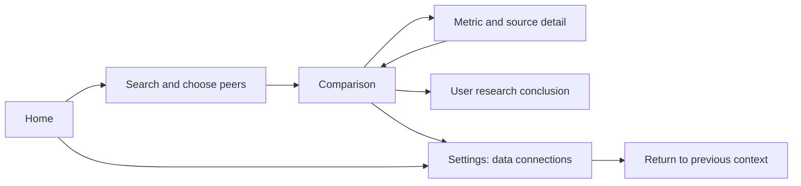

# UI Design Brief: Company Comparison and Valuation

Updated: 2026-10-28. Audience: teammate owning UI design, navigation and interaction flows.

**Start here for UI work.** This is a shared design brief, not evidence that the backend exists or that financial formulas/authentication have been approved. The [proposal](../product/AlphaQuant_Proposal.md) owns approval status; [feature catalogue](../requirements/Financial_Analysis_Features.md) describes the longer-term ideas; [implementation plan](../requirements/Comparison_Implementation_Plan.md) records proposed backend contracts and open decisions.

## Backend update for UI integration (2026-10-28)

Browser OAuth is now selected (AQ-D022), and the comparison-1 financial baseline was finalized under user delegation. Use **Connect with Alpaca**, Cancel, access-test status and Disconnect; no Alpaca API-key/secret/password fields for this adapter. Earlier API-key/OAuth alternatives below are historical mockup context only. Other future adapters may still have their own reviewed fields.

The UI-independent backend now exists: `ComparisonBackend` supplies browser authorization, IEX access testing and two-to-five-company snapshots. Annual/TTM analysis and guarded P/E/EV-sales are implemented and fake-provider tested. The Desktop project was intentionally untouched; screens are not yet wired. Start integration at [Alpaca OAuth setup and C# composition guide](Alpaca_OAuth_Setup.md), using [financial definition comparison-1](../requirements/Financial_Definitions.md). No registered OAuth app or deployed broker exists yet, so real Connect must show a configuration-required state until the public broker origin is supplied.

Production OAuth needs the server-held client secret; never ask users to paste it. Tokens are session-only and data-scope consent uses the paper account environment without implementing any trading. Free Render preview hosting is documented as a candidate, not a deployed/guaranteed service. Retain source/age and missing-evidence states. Capital/split/scope reviews are explicit inputs; do not invent them to make valuation cells populate. Session calendar detection is not implemented—use time/age and an unknown-session label where appropriate.

## Agreed direction

- Research, financial comparisons and valuation only; no trading, account balances, orders or automatic buy/sell recommendations.
- US domestic non-financial companies, US-GAAP, USD; five annual years when available, with missing/comparability warnings.
- SEC EDGAR remains the filing-evidence source. Users choose a market-data provider from a menu of supported options and connect their own account. Keep a free usage route; optional user-owned paid subscriptions may be supported without making payment mandatory. No in-app purchases or required paid hosting. Alpaca Basic IEX is the first planned adapter; additional providers are not selected or implemented.
- Stream while comparison is open when supported by the active provider and the user's entitlement. Show actual feed coverage, real-time/delayed/EOD status, event time, price age and connection state. IEX is not the consolidated US market. Do not silently substitute delayed data for the selected real-time workflow.
- TTM (trailing 12 months) results separate from annual history. Current valuation only; historical valuation charts, DCF and forecasts are later.
- Alpaca uses browser OAuth; its tokens remain in memory for the session. No API-key/password fields, Remember checkbox, plaintext settings or persistent token store for this adapter.
- Complex/unverifiable capital structures may show unavailable valuation with a reason; retain valid fundamentals for those companies.
- User owns the investment conclusion. The app supplies evidence and comparisons.

## What exists today

Avalonia Desktop already has Home, Search Companies, company detail, Settings (SEC contact only) and Release Notes. Current details show latest annual facts and three test-0 metrics (revenue growth, net margin and current ratio). Those metric definitions are unapproved spike behavior; they are not the agreed final comparison set.

The new backend implements Alpaca browser-OAuth preparation, an IEX adapter, five-period annual history, TTM and guarded P/E/EV-sales. There is no production comparison screen wiring or live-provider verification yet. Do not label synthetic data live.

Existing navigation owner: src/AlphaQuant.Desktop/ViewModels/MainWindowViewModel.cs. Views live in src/AlphaQuant.Desktop/Views; behavior in ViewModels. For design-only work a standalone HTML/React prototype is acceptable as a proposed workflow, but no prototype framework or new application dependencies have been selected. Coordinate before modifying production view models or shared contracts.

## Primary prototype flow

Home -> find companies -> choose peers -> comparison -> metric/source detail -> optional user research conclusion.

Settings -> data connections is reachable from Home, comparison and connection-error states, then returns to the initiating context. Preserve company selections, search query and valid financial results while navigating/retrying. Two-to-five-company selection is the proposed bounded design sample; exact interaction layout is teammate-owned.

## Screens and suggested controls

| Screen | Design content | Status |
|---|---|---|
| Home | Start comparison, resume research if later supported, Settings | Existing Home; new actions proposed |
| Company selection | Name/ticker search, company identification, Add/Remove, selected count, Compare | Search exists; multi-selection proposed |
| Comparison | Companies as columns or rows, metric groups, annual/TTM distinction, historical trends, data quality, connection status | Proposed; layout chosen by teammate |
| Metric/source detail | Formula, inputs, units, period, dates, definition version, filing link, unavailable reason | Some spike provenance exists; expanded panel proposed |
| Settings / data connections | Separate SEC section and market-provider menu, provider-specific setup, connection test, entitlement summary and activation | SEC contact exists; provider menu/Alpaca integration proposed |
| Research conclusion | User notes, horizon, risks, conclusion | Candidate later workflow; persistence/release not approved |

### Settings: SEC EDGAR

Retain working contact email input, Save and Clear Saved actions. Explain that the contact identifies requests to the SEC. This is not a provider login or secret and is already stored locally in settings.json; it does not change the session-only rule for Alpaca secrets. Missing/invalid contact blocks SEC requests with an actionable setup message.

### Settings: market-data provider menu

Approved UI direction, 2026-10-28: provider selection -> provider-specific setup -> test connection/access -> review capabilities -> activate -> manage/change. Keep SEC separate; changing market-price provider does not replace SEC source evidence.

Use provider cards or a selector. Each option shows provider name, supported data, authentication method, free/paid availability, coverage/freshness limitations and implementation status. Pricing descriptions are indicative and need rechecking; do not hard-code unverified subscription amounts or guarantee access based on a plan name.

| Menu option in the prototype | Status and behavior |
|---|---|
| Alpaca | First planned working integration; Basic/IEX is the initial evaluation route. Today it is still a mock connection, not implemented. |
| Additional provider examples | Clearly labelled Planned or illustrative placeholders; no real connection button until an adapter is implemented and reviewed. No other vendor is approved by this brief. |

Future supported paid options let users bring subscriptions they already own. AlphaQuant does not purchase/upgrade accounts, share provider credentials or promise a paid plan has particular rights. Provider eligibility and permitted use are checked individually. Free-tier entitlement is not proof of redistribution permission.

### Provider-specific setup and activation

The selected adapter supplies a reviewed field description and capability model to the UI. Show only fields/actions relevant to that provider: API key, key ID plus secret, or browser authorization. Never collect the provider account password or ask users to enter an endpoint URL. When switching providers, clear the previous provider's form values and never pass its credentials to the new adapter.

1. **Select:** open the chosen provider's setup panel; preserve the active comparison and SEC configuration.
2. **Enter/authorize:** explain the required fields and session-only secret retention. Provider account/setup links can open in the system browser when needed.
3. **Test connection and access:** validate required fields, authenticate through a fake service in the prototype, then report what data the account can actually access. Do not label local syntax validation as a successful network test.
4. **Review capabilities:** show feed/venue coverage, entitlement-based real-time/delayed/EOD access, streaming versus snapshot support, applicable symbol/connection limits and any unverified capabilities. Authentication success alone does not prove data permission or availability.
5. **Activate:** make this the one active market-price provider after a successful usable access test. If the required real-time workflow is unsupported, show the mismatch and keep activation for that workflow disabled; supporting a delayed-only workflow needs separate scope agreement.
6. **Manage/change:** show active provider and safe status, Test again/Reconnect/Disconnect/Change actions. Keep the old active provider until a replacement is ready; at activation stop the old stream before starting the replacement. If activation fails, preserve fundamentals and show an explicit disconnected/failed state rather than mix feeds.

Only one market-price provider is active at a time in this design scope. When activating a replacement, reset live price-dependent results until the new source supplies valid values; retain old values only as explicitly labelled historical snapshots with their original source/time. Revalidate security mapping and feed compatibility. Never mix rows from different providers without explicit source labels or silently reuse stale prices.

### Alpaca-specific mockup

Show **Alpaca** as the provider and **Basic / IEX** as the initial expected feed; reflect verified entitlements instead of assuming every account has the same plan. Show limited-venue text, connection/access summary and Connect/Test, Cancel, Activate, Disconnect and Clear controls according to state. Keep UI commands provider-neutral.

Use **Connect with Alpaca** to open the system browser, with Cancel during authorization. If the broker origin is not configured, show a configuration-required message; never ask for the application's client secret. On return, test access for the selected symbols before activating IEX. Authorization success, an available sample trade and an acknowledged stream subscription are separate states.

No Alpaca API-key/secret/password, funding/deposit, live-trading selector or order controls. No paid-upgrade flow. Consent is data-scope and uses the paper account environment; AlphaQuant executes no simulated or real orders. Disconnect clears the in-memory session and stops the feed; closing comparison only cancels that stream. Do not imply Disconnect revokes provider authorization.

See [Alpaca OAuth setup](Alpaca_OAuth_Setup.md) for the current composition contract and server/registration steps. Other future adapters may provide reviewed credential fields, but no additional authentication route is implemented for Alpaca.

## Financial comparison content

The comparison-1 baseline is now finalized for implementation under user delegation; it is not independently finance-certified. Use the implemented backend results and source panels, with fake providers during UI development. Do not duplicate production formulas in UI code.

| Group | Display | Context required |
|---|---|---|
| Growth | Annual revenue and revenue growth | Current/prior periods; first growth unavailable if no sixth year |
| Profitability | Operating margin | Annual versus TTM explicit; operating income and revenue inputs |
| Cash generation | Operating cash flow | Duration, currency; do not label it free cash flow |
| Financial position | Debt and cash balances | Balance-sheet date and scope; neither missing value treated as zero |
| Price | Active-provider eligible price; initial Alpaca example is an IEX last eligible trade | Provider/feed, price semantics, venue coverage, delay, event timestamp, receive time/age and connection state |
| Valuation | Trailing P/E | TTM diluted EPS basis, price time, unavailable for invalid/non-positive/unverifiable inputs |
| Valuation | EV / TTM sales | Enterprise-to-equity bridge, shares and balance-sheet dates, missing adjustments and limitations |
| Evidence | Source/quality | Filing date/accession/link, retrieval time, metric version, restatement/mapping warnings |

Do not conflate outstanding shares for equity value with weighted-average diluted EPS shares. Complex structures can have valid operating metrics but unavailable valuation. Show historical figures and current market-price-derived results with distinct dates rather than implying all inputs are current.

### Prototype-only numbers

A fictitious single-class issuer: revenue FY 1,200 million; current 9M YTD 1,000 million; prior comparable 9M YTD 850 million -> TTM revenue 1,350 million. Reviewed-for-example TTM operating income 270 million -> margin 20%. Price USD60, assumed compatible TTM diluted EPS USD3 -> P/E 20x. Shares 100 million, debt 400 million, cash 100 million and confirmed zero other claims -> EV 6,300 million; EV/sales about 4.67x. Every number is synthetic, not a real issuer or evidence of backend/finance approval. Full examples and caveats are in the feasibility review.

## State catalogue for fake-data design

| State | Visible behavior |
|---|---|
| No companies | Helpful empty state and select-companies action |
| Loading financials | Progress, Cancel; retain previous usable data |
| Missing/invalid SEC contact | Setup message with return-to-context Settings route |
| No active market provider / disconnected | Fundamentals usable; price-dependent outputs unavailable with Choose provider/Connect action |
| Planned provider selected | Explicit Planned label; setup cannot masquerade as a working connection |
| Provider setup pending | Correct fields for the selected provider; no cross-provider credential reuse |
| Authentication succeeds, entitlement unknown | Access verification pending; do not activate or claim live data |
| Authentication succeeds, required access denied | Explain missing capability/permission; no automatic purchase or delayed fallback |
| Replacement provider test fails | Keep previous provider active if usable; retain company selection and SEC data |
| Switching active provider | Stop old stream, revalidate symbols and reset source-dependent prices; no unlabelled mixed-feed values |
| Connecting / authenticating | Cancellable progress; never show secret in failure details |
| Connected, no price yet | Awaiting IEX price; connected is not the same as a fresh trade |
| Streaming active provider | Provider/feed, price/time/age, coverage/delay disclosure; IEX example labelled limited venue |
| Old price / network loss | Retain old value only with explicit age/status; no silent zero or feed fallback |
| Market closed / session unknown | Last observed event and session label; no promise of continuous trades |
| Connection already in use | Explain provider connection cap and recovery; no reconnect loop that hides the error |
| Invalid credentials / entitlement | Actionable reconnect/edit message; no paid-upgrade flow |
| Unsupported/missing facts | Per-cell unavailable reason; other valid metrics remain visible |
| Complex/unverifiable capital structure | Valuation unavailable with reason; supported fundamentals remain |
| Cancelled/failed refresh | Previous usable snapshot remains; retry available |
| Different periods/restatement | Visible warning and inspectable dates/source selection |

Use text/icons alongside colour, keyboard-reachable controls, readable scaling and sensible focus after errors/dialog return. A 60-second old-price threshold is a backend-plan proposal, not an approved rule; design for a generic age/status supplied by the service.

## Proposed UI/backend boundary (conceptual, not compiled contracts)

- Company identity: entity/CIK, provider symbol/class mapping, name and supported status.
- Metric cell: label, nullable decimal value, unit, annual/TTM/instant basis, period, status/reason, input/source references and definition version.
- Price cell: symbol, nullable price, currency, feed/coverage, event and receive timestamps, age, validity and session.
- Provider descriptor: stable provider ID, display name, implementation status, reviewed connection-field descriptors/authentication type and claimed capabilities. Never arbitrary executable form logic from remote provider content.
- Access test result: authentication status, verified/unknown entitlements, feed coverage, freshness category, streaming/snapshot support, safe limits/errors and eligibility for the requested workflow.
- Connection: selected versus active provider IDs, status, safe error code/message, cancellable test/activation and disconnect actions. Credentials belong to an isolated session service, not a research/export model.
- Comparison: selected identities, financial snapshots, per-row/cell warnings, refresh status and stream subscription lifecycle.

The UI consumes these results and commands. It must not implement SEC mappings, TTM construction, EV arithmetic or provider sockets inside views. Agree actual C# types with the backend owner before production integration. No shared quote backend is planned.

## Teammate deliverable and review checklist

1. Create linked screens with synthetic fixtures and demonstrate the main flow plus setup, failure, missing-data and disconnect states.
2. Separate confirmed requirements from proposed layout/authentication choices; annotate pending decisions in the design.
3. Demonstrate inspection of formula/inputs/source and annual-versus-TTM differences.
4. Preserve search/selection across Settings and show that missing market access does not block fundamental research.
5. Keep credentials fake; design work must not save real credentials/contact details or trigger SEC/Alpaca requests.
6. Demonstrate free versus optional paid provider choices, planned-provider labels, a successful access test, successful authentication with denied/unknown data access, and a failed provider switch without losing SEC evidence.
7. Review UI/backend contracts together before integrating production files. A prototype does not approve financial definitions or guarantee provider eligibility.

Exact next shared action: integrate the backend facade into the teammate-owned provider menu/browser-connect and comparison/evidence screens using fake services first, then complete manual OAuth deployment/registration before an authorized live evaluation. DCF, automatic ratings, persistent research and additional metrics remain candidates in the feature catalogue.
