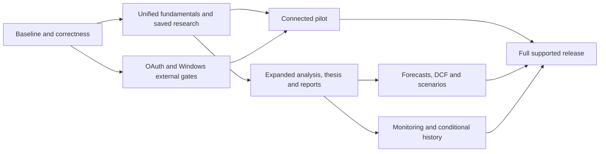

# AlphaQuant autonomous development plan

Version: 1.0 approved for stage execution on 2026-11-13
Updated: 2026-11-13 Asia/Singapore

The owner approved execution on 2026-11-13 with "Proceed with next few stages and continue developing autonomously." Current work, evidence and blockers are recorded in the stage ledger.

The standing stage policies below are approved. Routine implementation, checks and Git delivery within these contracts do not need repeated approval. External access and release gates still require actual evidence.

## Entry points and authority

- [Execution runbook](Stage_Runbook.md) defines invocation, resumption and stopping rules.
- [Stage ledger](Stage_Ledger.json) is the single source of scheduling dependencies, progress, blockers and evidence.
- This document defines outcomes, work packages and acceptance criteria.
- [Project proposal](../product/AlphaQuant_Proposal.md) owns product decisions. [Financial definitions](../requirements/Financial_Definitions.md) owns comparison-1. New definitions get versioned companion documents rather than silently changing existing results.

Agents read tracked records rather than depend on previous chats, ignored files or one laptop.

## Confirmed standing decisions

The owner selected these during planning on 2026-11-13:

1. Cover the full proposed product through DCF, scenarios and the research workflow.
2. A proceed instruction authorizes implementation, appropriate dependency changes, checks, docs, commit, push, PR and automatic merge after self-review and passing required checks. Do not ask again for these routine actions.
3. Record exact external blockers and continue independent ready work. Never alter financial rules or introduce a paid fallback to force completion.
4. Delegate documented, versioned financial definitions/defaults to the executing agent within this scope, backed by worked examples and regression checks. This is project implementation authority, not independent financial certification.
5. Use local SQLite for durable research, with migrations, backup and recovery. Keep credentials/tokens out of research storage, backups, exports and diagnostics.
6. Allow bounded SEC validation using the configured contact email in the SEC identification header, and Alpaca market data after explicit user connection of an eligible account. Never commit contact details/secrets. No automated login, account creation, vendor messages or credential extraction.

Retain C#/.NET, Avalonia/MVVM, the ASP.NET Core token broker, SEC fundamentals and replaceable market adapters. Required incremental pilot/app cost remains zero. No trading, broker-account management, app-generated recommendations, paid hosting/subscriptions, cloud sync or framework rewrite is implied. Project authority does not bypass platform/tool approvals.

## Baseline and milestones

Planning baseline: main 13ec3af, integrated Windows preview, comparison-1 annual/TTM/evidence, reviewed valuation JSON, OAuth/IEX code, Windows packaging and CI. Recorded integration evidence is 203 tests and CI/package startup. S01 verifies the actual current baseline and tools rather than treating this count as an enduring goal.

Outstanding: live SEC reconciliation, registered/deployed OAuth, real provider acceptance, trusted distribution, practical reviewed-evidence UI, persistent research and DCF. Duplicate test-0/comparison-1 workflows remain.

| Milestone | User outcome | Required work |
|---|---|---|
| M1 Reliable fundamentals | One traceable comparison, saved peers and offline research | S01-S06 and relevant usability checks. Label fundamentals-only previews explicitly |
| M2 Connected pilot | Verified per-user IEX and supported valuations with install/recovery | S01-S11 and applicable external gates |
| M3 Research workspace | Expanded analysis, theses and reproducible reports | S12-S15 and prerequisites |
| M4 Valuation modeling | Forecasts, DCF, scenarios, sensitivity and reverse DCF | S16-S18 and prerequisites |
| M5 Maintained full product | Monitoring, conditional historical valuation and hardened delivery | S19-S20, with actual rights/data evidence for conditional modules |

Engineering ZIP, fundamentals preview, connected pilot and full product are different outputs. A completed code task does not certify a live gate.

The research/model branch can advance while the pilot waits on external access. Missing gate evidence still prevents the corresponding release claim.

## Planning timeline

Effort ranges are initial estimates, not deadlines. One developer-day means about six focused engineering hours including verification/review. Agent wall time varies. Account, rights and signing waits are excluded.

| Workstream | Stages | Initial focused effort |
|---|---|---|
| Baseline, validation and coherent comparison | S01-S03 | 5-9 developer-days |
| Storage, saved research and evidence UI | S04-S06 | 6-11 developer-days |
| OAuth, live acceptance and pilot | S07-S11 | 7-14 developer-days plus external waits |
| Expanded analysis, thesis and reports | S12-S15 | 10-18 developer-days |
| Forecasts, DCF and scenarios | S16-S18 | 10-18 developer-days |
| Monitoring and full-product hardening | S19-S20 | 6-11 developer-days plus conditional data waits |

Envelope: roughly 44-81 focused developer-days, around 9-17 working weeks at one full-time developer's capacity. S01 revises estimates from concrete tasks. Parallel developers require compatible contracts and agreed file ownership. This plan does not authorize spawning subagents.

Prefer numerical order but schedule by ledger dependencies. A blocked live stage must not freeze unrelated UI/storage/model work. S12-S18 can be engineered without a live pilot release, while their release claims remain subject to validation.

## Stage contracts

Each work-package ID is a checkpoint. Store completed IDs, partial progress and evidence in the ledger. Stage completion includes acceptance, relevant checks, self-review, documentation and authorized Git delivery. Default tests are deterministic. Live checks are separate dated evidence.

### S01 Baseline audit and execution readiness

Dependencies: none. Areas: docs, solution configuration, test inventory and existing service/UI boundaries.

- S01.1 Fetch safely and record actual baseline, local work, tooling, build/test/CI results and execution commands. Preserve unrelated changes.
- S01.2 Trace UI-to-service flows and catalogue reproducible finance, lifecycle, cache, cancellation and accessibility defects with severity/reproduction steps.
- S01.3 Reconcile stale context and story/feature status, inventory definitions/fixtures and refine estimates and release blockers.
- S01.4 Fix baseline blockers needed for execution and leave the next package unambiguous. Put unrelated enhancements in their owning stages.

Acceptance: a fresh agent can build/test/resume from tracked records. Critical known regressions are fixed or prevent dependent work explicitly. Matching an old test count is insufficient.

### S02 Financial source validation

Dependencies: S01. Areas: Core analysis, SEC parser, source-backed fixtures and finance definitions.

- S02.1 Define a bounded matrix for up to five intended-universe candidates such as MSFT, AAPL, COST, KO and AMZN, subject to verified scope. Include annual/quarterly periods, YTD bridge, restatement and unsupported/missing cases.
- S02.2 With approved configuration, retrieve only needed SEC facts through the paced client, honoring current access rules. Record accession, period, retrieval time and source URLs. Commit minimal public-fact fixtures, never the configured contact/header.
- S02.3 Recompute representative growth, margin, OCF, TTM EPS and valuation independently of production arithmetic. Freeze expectations and fix mismatches with versioned changes where needed.
- S02.4 Publish case-by-case reconciliation and coverage gaps. Agent reconciliation is not independent professional review.

Acceptance: source and worked results agree within documented precision. Conflicts/amendments/future facts remain explicit. Live evidence exists. Without E01, complete independent packages and block live validation rather than invent results.

### S03 One comparison workspace

Dependencies: S01. Areas: Desktop, presentation contracts and UI integration tests.

- S03.1 Specify one comparison-1 cell contract with annual/TTM basis, value/status, source/version, price age and unavailable reason. Keep arithmetic in Core.
- S03.2 Connect two-to-five-peer selection, raw-value filters/sorting, history and evidence. Preserve missing-values-last ordering, prior snapshots and Settings context.
- S03.3 Consolidate duplicate navigation. Isolate test-0 until explicitly versioned replacements exist. Never rename net margin to operating margin or assets to cash.
- S03.4 Verify keyboard/scaling, focus, cancellation, late responses, removed symbols, stream disposal and navigation recovery.

Acceptance: one coherent source-traceable comparison with lifecycle regression coverage. Real-data uncertainty remains labelled until S02 closes.

### S04 SQLite storage and recovery

Dependencies: S01. Areas: repository contracts, Infrastructure storage, migrations and recovery tests.

- S04.1 Select a compatible maintained provider after license review. Version schemas for identities, saved sets, snapshots and later thesis/scenario revisions, implementing only currently needed tables. Preserve separate contact settings.
- S04.2 Implement parameterized access, atomic transactions, stable IDs/timestamps and serialized writes/cancellation. Never serialize arbitrary session objects.
- S04.3 Add verified pre-migration backup, failed-migration recovery, restore and corrupt/read-only/in-use handling. Never delete a user database to fix startup.
- S04.4 Test fresh install, supported migration, interrupted writes, locks, corruption and restore in isolated directories. Verify no token/secret leakage.

Acceptance: prior research stays recoverable, migration/restore tests pass and schema/recovery are documented. SQLite does not authorize cloud sync or credential persistence.

### S05 Saved peers, watchlists and offline research

Dependencies: S03, S04. Areas: saved research, cache/snapshots and Desktop flows.

- S05.1 Persist named peer sets, duplicate-free watchlists and versioned metric/filter presets.
- S05.2 Save bounded immutable financial snapshots with source/definition/retrieval metadata. Refresh must not rewrite historical research silently.
- S05.3 Support restart/offline opening. Old prices are dated observations, never current valuations. Price storage requires actual provider rights.
- S05.4 Define explicit rename/delete/recovery behavior and test interrupted writes, missing cache, unavailable facts and old definitions.

Acceptance: US-09/US-10 work across restart, network loss and failed refresh, without losing selection/evidence or bypassing storage rights.

### S06 Reviewed valuation inputs without JSON editing

Dependencies: S03. Areas: evidence store/models, structured forms and valuation provenance.

- S06.1 Add issuer/class, split, share-date and capital fields with explicit unknown/zero choices and source/review references. Retain validated JSON interchange if useful.
- S06.2 Guide review of source filings/candidate facts. Extraction never auto-confirms scope, class compatibility, complete debt or zero preferred/NCI claims.
- S06.3 Show EV bridge, outstanding versus diluted shares, dates, currency and precise missing reasons. Preserve simple-class restrictions. Persist only after S04 and permitted-storage checks, otherwise remain session-only.
- S06.4 Test partial/stale/future/conflicting reviews, explicit zeros, atomic replacement, clear and recomputation.

Acceptance: traceable reviewed inputs yield valuation only when both evidence and price satisfy the baseline. Entry/parsing never implies certification.

### S07 OAuth broker operational readiness

Dependencies: S01. Areas: broker/client security, container/configuration and operational docs.

- S07.1 Audit state/challenge binding, replay/one-time delivery, timeouts, cancellation, scopes, redirects, logging/redaction and disposal.
- S07.2 Build/smoke the container when tools exist. Use synthetic secrets for health, denial, expiration, rate limits and restart loss of pending sessions.
- S07.3 Prepare zero-cost deployment configuration, health/cold-start/recovery and secure secret placement. Recheck current host terms/availability/cost. No implicit accounts/secrets.
- S07.4 Verify configured/unconfigured desktop and public-origin behavior. Record actual operational evidence and missing prerequisites.

Acceptance: executable deployment package and local/container evidence. Missing tooling stays blocked. A setup guide is not deployment proof.

### S08 Real OAuth and IEX acceptance

Dependencies: S03, S07. External gates: E02, E03. Areas: real connection and fault-injection acceptance.

- S08.1 Verify non-secret registration, exact callback, host, intended-use permission and zero-required-cost operation.
- S08.2 After explicit user connection, test consent/cancel/denial and selected-symbol access. Record actual capabilities/limited venue, not inferred plan entitlements.
- S08.3 Check subscriptions, no-price-yet, peer changes, reconnect, stale/corrected trades, limits, disconnect and exit with bounded observations plus fault injection. Never wait indefinitely for a trade.
- S08.4 Reconcile a dated eligible quote and supported valuation. Preserve fundamentals on failure and retain only non-secret evidence. Quiet markets are not automatically dead connections.

Acceptance: a real eligible account demonstrates permitted authorization and data access. Simulated faults do not substitute for live evidence. Missing access stays blocked while independent stages continue.

### S09 Windows usability, upgrade and trusted distribution

Dependencies: S03, S04. External gate: E04. Areas: accessibility, packaging, installation and recovery.

- S09.1 Check keyboard, focus, contrast, supported scaling and error recovery using isolated data. Record tested environments.
- S09.2 Choose a no-required-cost install/update/uninstall/data-retention route that preserves research/settings through supported upgrades.
- S09.3 Test clean install, upgrade, failed upgrade, rollback and restore in an available clean supported environment. Label ZIP fallback accurately.
- S09.4 Establish trusted signing/distribution or record the gate. Never disable OS protections or equate self-signing/checksums with generally trusted identity.

Acceptance: US-11/US-12 evidenced for the claimed environment/route. Packaging can be verified while trusted distribution remains incomplete.

### S10 Pilot usability, diagnostics and feedback

Dependencies: S03, S05, S06. Areas: help/about, diagnostics and task-based checks.

- S10.1 Expose version/build identity, useful errors and contextual setup/help.
- S10.2 Add explicit diagnostics preview/export with bounded safe metadata, excluding secrets, contact, headers, home paths and unnecessary research.
- S10.3 Provide a feedback draft/route the user submits. No automatically sent messages, issues or telemetry.
- S10.4 Exercise selection, comparison, evidence, offline/saved research, valuation and recovery tasks. Do not fabricate participant/user-study findings.

Acceptance: US-13 and redaction checks pass with reproducible task evidence. Missing external participants do not stop independent engineering.

### S11 Connected pilot release

Dependencies: S02, S03, S05, S06, S08, S09, S10. External gates: E02-E04.

- S11.1 Resolve critical/high release defects and reconcile real-data/provider acceptance, permission, zero-cost host and supported distribution.
- S11.2 Build the exact release commit on clean CI. Verify hashes, install/migration/recovery and absence of private configuration in archives.
- S11.3 Publish only when the connected acceptance matrix passes. Otherwise retain a draft or accurately named fundamentals-only preview, keeping connected criteria open.
- S11.4 Record version, commit, artifacts, environments, deployment/recovery and limitations. Identify the next ready package.

Acceptance: a new eligible user can follow setup, retain research across restart/upgrade, connect and reproduce supported results. Claims never exceed evidence.

### S12 Expanded fundamentals and efficiency metrics

Dependencies: S03, S04. Areas: versioned finance definitions, SEC mappings, UI evidence and fixtures.

- S12.1 Specify gross/net margins, current ratio, EPS/operating-profit growth, CAGR, FCF/cash conversion, ROE/ROIC/turnover, net debt/coverage, sourced debt maturities and share/dividend/buyback measures. Implement in bounded checkpoints, leaving genuinely note-dependent data gaps unavailable.
- S12.2 Define ownership, periods, average versus ending denominators, tax/capital/lease/debt policies and cash-flow signs. Negative/zero bases do not silently become meaningful growth. Explain selected definitions and alternatives.
- S12.3 Implement source-traceable typed calculations and versioned stored results, without overlapping tag sums or UI formulas. Give the test-0 net-margin/current-ratio stories explicitly supported replacement definitions.
- S12.4 Independently recompute examples and reconcile real sources when configured. Test missing/conflicting facts, fiscal mismatches, negative equity/invested capital, tag changes and overflow.

Acceptance: named measures have implemented/versioned behavior and evidence, including explicit per-issuer unsupported-data reasons where applicable. An unfinished metric implementation stays open, not disguised as unsupported data. Deferring an entire required metric needs an explicit owner scope decision before claiming full-stage completion. Each delivered metric has scope, mappings, edge policies and reproducible expectations. Unsupported values cannot pass filters. Delegation is not professional certification.

### S13 Quality flags and explainable screening

Dependencies: S05, S12. Areas: rules, saved presets and screening UI.

- S13.1 Version supported earnings/cash, receivable/inventory, margin, leverage/coverage and dilution rules. Defaults/thresholds are inspectable and user-adjustable.
- S13.2 Display inputs, dates, trigger, materiality and limitations. A flag prompts investigation, not allegations, distress probabilities or recommendations.
- S13.3 Add saved combinations and optional user-weighted ranks with visible components, weights, ties and coverage. Missing data never becomes zero, passes filters or improves rank.
- S13.4 Test threshold boundaries, sparse/stale history, overlaps and saved-rule upgrades.

Acceptance: every flag/rank contribution is reproducible. No unexplained overall buy/sell rating.

### S14 Versioned investment-thesis workspace

Dependencies: S04, S05. Areas: SQLite research versions and Desktop editor.

- S14.1 Add thesis, variant view, catalysts, risks, invalidation conditions, horizon, peer-comparability notes and user-authored conclusion.
- S14.2 Attach immutable comparisons, sources and later scenario IDs. Preserve research revisions instead of overwriting history.
- S14.3 Add explicit save/autosave/recovery states, conflict handling and controlled delete/restore/export using storage contracts. Never serialize session objects.
- S14.4 Test interrupted editing, supported concurrency, missing linked snapshots and schema upgrades.

Acceptance: restart/recovery preserves revision history. User judgment stays distinct from calculations. Portfolio suitability, taxes and position sizing remain outside scope.

### S15 Spreadsheet, CSV and PDF reports

Dependencies: S05, S12, S14. Areas: immutable export DTO, renderer and preview.

- S15.1 Capture consistent identity, definitions, periods, source links, retrieval/price times, missing reasons, assumptions and user conclusion.
- S15.2 Deliver CSV/XLSX/PDF through compatible maintained no-required-cost libraries with suitable licenses. Label units/rounding, prevent spreadsheet text formula injection and silent external recalculation of frozen reports.
- S15.3 Preview readable wrapped/large/empty output. Sharing remains a user action, no automatic upload/email.
- S15.4 Check locales, Unicode, stale/missing values and partial filesystem failure. Reopen spreadsheets and render/inspect PDF pages with appropriate tools. Add scenario output when its stages land.

Acceptance: report values reconcile to the captured snapshot and preserve dates/limitations. Failed export cannot appear complete or modify the source research.

### S16 User-controlled forecasts

Dependencies: S12, S14. Areas: versioned assumptions, forecast engine and editor.

- S16.1 Specify nominal-USD unlevered forecasts with revenue, operating margin, tax, D&A, capex, operating working capital and cash-flow signs. Distinguish history, user assumptions and derived results.
- S16.2 Support 1-10 explicit years with validated ranges/transitions and immutable revisions linked to historical evidence.
- S16.3 Require explicit user assumptions rather than silently estimating WACC, beta, country risk, consensus or tax assets. Unknown inputs remain incomplete, and tax-loss benefits are modeled conservatively and explicitly.
- S16.4 Compare to an independent worked model and test horizons, losses, zero revenue, negative cash flow, invalid assumptions, cancellation and replay.

Acceptance: identical input versions reproduce forecasts and annual cash-flow bridges. Normalization/unsupported cases are documented. No hidden optimistic defaults or paid consensus source.

### S17 Discounted cash flow valuation

Dependencies: S06, S16. Areas: DCF definitions/engine, capital bridge, evidence and exports.

- S17.1 Define FCFF as modeled after-tax EBIT plus D&A minus capex minus change in operating working capital, with explicit signs. Use nominal USD, user-supplied WACC and end-year discounting. Never mix equity cash flows with WACC or silently adjust leases/stock compensation.
- S17.2 Discount forecasts and perpetual-growth terminal value from year N+1 FCFF. Require WACC greater than terminal growth, with a sustainable terminal reinvestment policy. Unsupported terminal economics remain explicit. Exit-multiple terminal value requires a separately specified basis.
- S17.3 Bridge operating enterprise value to equity using reviewed non-operating assets/cash, debt, preferred/NCI and actual shares. Absolute model value can be inspected without prices, while current-price upside needs an eligible dated quote. Unsupported structures stay unavailable.
- S17.4 Show cash flows, factors, terminal contribution, capital bridge and assumption/source versions. Integrate persisted models and reports, labelled assumption-dependent.
- S17.5 Reconcile independent models and test timing, growth/discount boundaries, negative equity, overflow and share scaling. Never clamp negative outputs to create a positive target.

Acceptance: forecasts, discounting, terminal policy and capital bridge reconcile within declared precision. Invalid/unstable models explain why. No recommendations or return guarantees.

### S18 Scenarios, sensitivity and reverse DCF

Dependencies: S17. Areas: scenario revisions, sensitivity UI/exports and bounded solver.

- S18.1 Add bear/base/bull user assumption sets with revision history. Labels are not probabilities.
- S18.2 Build bounded cancellable sensitivity grids for WACC/growth and selected drivers. Cap model evaluations and explain invalid cells.
- S18.3 Start reverse DCF with one solved constant forecast revenue-growth assumption, all other assumptions fixed, finite bounds, tolerances and evaluation limits. Validate monotonicity/uniqueness. Report no/multiple/uncertain solution or failure instead of invented precision.
- S18.4 Display target price, bridge, bounds, iterations and forward-model reconciliation. Other solved parameters need separately documented submodels.
- S18.5 Test non-monotonic cases, infeasible targets, negative/zero inputs, near-singular terminal cases, cancellation, replay and report alignment.

Acceptance: inspectable drivers explain value changes and solver outputs reproduce the target within stated tolerance. No hidden probabilities or automatic investment classification.

### S19 Monitoring and historical comparisons

Dependencies: S05, S12, S14. Conditional external gate: E05 for historical valuation.

- S19.1 Compare snapshots on user-initiated refresh, separating new filings, restatements, definition revisions and changed business values.
- S19.2 Add in-app user-defined thesis-condition reminders/flags with evaluation time/source and review history. Do not imply continuous background monitoring.
- S19.3 Plot sourced historical fundamentals. Historical valuation additionally requires dated prices/shares, corporate actions, then-available filings and valid storage/use rights. Never combine today's restated fundamentals with old prices and call it point-in-time valuation.
- S19.4 If suitable zero-required-cost historical data is unavailable, block only this package with exact source/right gaps and finish independent monitoring. Never fabricate series, buy data or silently substitute vendors.
- S19.5 Test duplicate refreshes, out-of-order filings, definition changes, missing observations and deleted theses. OS/email notifications, schedules and external sharing need separate authorization.

Acceptance: supported changes are reproducible and explain causes. Historical valuation remains incomplete until E05 closes. A reduced-scope monitoring release does not complete every catalogue feature.

### S20 Full-product hardening and release

Start dependencies: S13, S15, S18. Completion/release additionally requires S11 and S19. External gates: all applicable release gates. Independent hardening can proceed while a release dependency is blocked, but S20 cannot be marked done.

- S20.1 Trace US-01 to US-13 and FA-01 to FA-07 to actual tests, UI evidence, definitions and limitations. Keep exclusions/conditional modules explicit, never rewrite old stories to pretend completion.
- S20.2 Exercise supported upgrades/restores, offline behavior, redacted diagnostics, stream/auth lifecycle, model replay, export accuracy and large supported data sets. Measure before making performance claims.
- S20.3 Fix blockers, review dependencies/licenses and prepare environment, rollback and artifact manifests. Repeat checks only when changes/failures justify them.
- S20.4 Verify the exact release commit on CI, clean Windows install/upgrade and permitted provider path. Publish only accurate supported scope and record residual limitations.

Acceptance: a supported user can install/upgrade, research, recover, compare/model, export and review changes without known critical defects. Excluded historical capabilities produce a reduced-scope release, not full-catalogue completion.

## External gates

| Gate | Closure evidence | Agent preparation | If unavailable |
|---|---|---|---|
| E01 SEC configuration | Valid approved local contact and standing bounded-call authorization | Matrix, harness, fixtures/report | Block live package, continue independent work |
| E02 OAuth app/account | Actual registration and explicit user connection of an eligible account | Callback guide and unconfigured states | No automated login/account creation or token extraction |
| E03 Permitted zero-cost host/provider | HTTPS configuration, intended-use evidence and zero required cost | Container, health and current terms/cost review | Record gaps, no paid fallback |
| E04 Trusted distribution/environment | Available trusted route and tested supported clean installation | Packages, manifests, signing/recovery procedure | Label unsigned output, no OS security bypass |
| E05 Historical data/rights | Licensed prices/shares/actions/then-available filings | Contracts, synthetic charts and gap states | Keep historical valuation incomplete, continue monitoring |
| E06 Execution tools/platform | Required SDK, container, native UI or other tool capability available | Reproducible commands and safe alternative checks | Block only affected verification, never invent a run |

Closure needs dated non-secret evidence and the exact capability verified. Configuration file existence is insufficient. Recheck current terms, pricing, eligibility and dependency compatibility at execution. Never request secrets in chat.

## Scope and technical defaults

### Original requirement traceability

| Existing requirement | Primary completion evidence |
|---|---|
| US-01/US-02 selection/retrieval | S01-S03, S08 for market failure handling |
| US-03/US-04 growth/source verification | S02/S03 and versioned metric evidence |
| US-05/US-06 compare/filter/sort | S03/S05/S13 |
| US-07/US-08 net margin/current ratio | S12 explicit supported definitions, never silent replacement with different measures |
| US-09/US-10 watchlist/offline | S04/S05 |
| US-11/US-12 accessibility/install/upgrade | S09, confirmed in S11/S20 |
| US-13 feedback | S10 |
| FA-01 comparable company analysis | S02/S03/S05/S12 |
| FA-02 quality/investigation | S12/S13 |
| FA-03 price valuation/historical ranges | S06/S08, conditional S19 historical valuation |
| FA-04 forecast/scenario/reverse DCF | S16-S18 |
| FA-05 investment thesis | S14 |
| FA-06 screening/shortlisting | S03/S05/S13 |
| FA-07 monitoring/reporting | S15/S19 |

This maps delivery, not completed requirements. S20 reconciles it to actual evidence and explicit exclusions.

### Implementation boundaries

- Required costs remain zero. Prefer runtime facilities and a small compatible SQLite dependency. New packages require purpose, compatible version and license rationale. No remote database, token persistence or stack rewrite by default.
- Alpaca IEX is first. Additional provider menu entries remain planned until a reviewed adapter is selected and implemented. New vendors, paid user-owned options and broad universe ingestion need separately bounded stage proposals.
- Initial issuer scope remains US domestic non-financial US-GAAP/USD. Banks, insurers, REITs, complex classes and FX need separate models. Fact availability is not scope certification.
- Version definitions and stored results. Require source-backed worked examples and independent recomputation. User controls assumptions/conclusions. No paid forecasts or automatic recommendations.
- SQLite holds research, not secrets. Backup/recovery precedes more persistence. Market-data retention needs actual rights.
- Historical valuation is conditional. No portfolio advice, LLM research agent, auto-sent reports/alerts or multi-user cloud collaboration is implicitly approved.

## Universal completion evidence

Use the [specialized skill library](../skills/Skill_Routing.md) to apply domain methods instead of treating stage work as a generic prompt. Its catalog maps stage hints, while the actual changed package decides what to load. SEC selection, numerical verification, UI behavior, connections and storage have distinct evidence requirements. Skill structure/helper checks are not proof of agent compliance or independent professional certification. Preserve the actual results in the stage checkpoint.

Record deliverables/files, actual validation commands/results, financial specs/worked fixtures, UI checks, dependency rationale and migration/provider evidence as applicable. Self-review does not pretend to be an independent second reviewer. Required checks pass for the exact PR head before normal merge, without force-push or bypassing protection. Reconcile concurrent main and recheck affected behavior. Update ledger, proposal, handoff and user docs with the next ready package.

Tests are deterministic by default, with bounded live checks recorded separately. Never invent a professional reviewer, live result or certification. Passing tests does not waive release/provider/distribution gates.

## Implementation references

These support interface/model background, not eligibility or certification. Recheck during execution.

- [SEC EDGAR API](https://www.sec.gov/search-filings/edgar-application-programming-interfaces): available fact/submission data and entity-level taxonomy context.
- [Alpaca OAuth](https://docs.alpaca.markets/us/docs/using-oauth2-and-trading-api): application authorization and registered callbacks. Do not copy sample trading scopes.
- [Microsoft.Data.Sqlite](https://learn.microsoft.com/en-us/dotnet/standard/data/sqlite/): proposed local provider family. S04 selects a compatible version and records rationale.
- [Damodaran's DCF questions](https://pages.stern.nyu.edu/~adamodar/New_Home_Page/valquestions/valquestions.htm): FCFF/modeling background. S16/S17 still require complete versioned implementation definitions.
